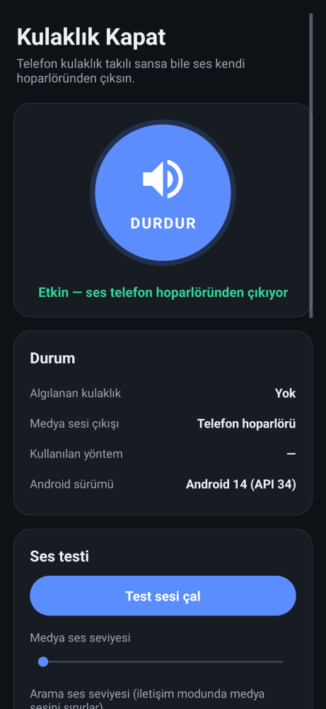

# Kulaklık Kapat (Disable Headphone)

Telefon kulaklık takılı sansa bile sesi telefonun **kendi hoparlöründen** çıkaran Android uygulaması.

Kulaklık girişi bozulunca ya da içine nem veya toz kaçınca telefon kulaklık takılı sanabilir ve hoparlörü susturur. Bu uygulama kulaklık çıkışını yazılımla devre dışı bırakır ve tüm sesleri hoparlöre gönderir. Root gerekmez.



## Kurulum (APK)

1. [`apk/KulaklikKapat-1.1.apk`](apk/KulaklikKapat-1.1.apk) dosyasını telefona indirin.
   - **1.0 sürümü yüklüyse önce onu kaldırın.** 1.1 farklı bir anahtarla imzalandığı için eskisinin üzerine kurulamaz.
2. Dosyayı açın. Android "bilinmeyen kaynaklardan yükleme" izni isterse verin.
3. **Yükle**'ye dokunun.

Android 6.0 ve üzeri sürümlerde çalışır.

## Kullanım

- Büyük **BAŞLAT** düğmesine dokunun. Kulaklık algılandığında ses otomatik olarak hoparlöre geçer.
- **Test sesi çal** ile sesin nereden çıktığını kontrol edin.
- Bildirim panelindeki Hızlı Ayarlar'a **Kulaklık Kapat** kutucuğunu ekleyerek uygulamayı tek dokunuşla açıp kapatabilirsiniz.
- Uygulama çalışırken bir bildirim görünür. **Durdur** ile her şey normale döner.

### Medya sesi arama sesi gibi çıkıyorsa: Shizuku (Android 9+)

İletişim modunda Android medya sesini telefon görüşmesi gibi işler (görüşme ekolayzırı, ses işleme, çoğu zaman mono). Sesin normal kalitede çıkması için **Shizuku ile medya yönlendirme** yöntemini kullanın. Bilgisayar ya da root gerekmez, telefon yeterli:

1. Play Store'dan **Shizuku** uygulamasını kurun (uygulamadaki *Shizuku'yu indir* düğmesi de oraya götürür).
2. Telefonda geliştirici seçeneklerini açın: *Ayarlar → Telefon hakkında → OS sürümü*'ne 7 kez dokunun.
3. Wi-Fi'ye bağlıyken Shizuku'yu açın, **Kablosuz hata ayıklama ile başlat** bölümündeki adımları izleyin (eşleştirme kodu bildirimden girilir).
   - Xiaomi/Redmi'de *Ek ayarlar → Geliştirici seçenekleri* içindeki **USB hata ayıklama (Güvenlik ayarları)** seçeneğini de açmanız gerekebilir.
4. Kulaklık Kapat'ı açın. *Shizuku izni ver* düğmesine dokunup izin verin.
5. Yöntem olarak **Shizuku ile medya yönlendirme**'yi (ya da *Otomatik*) seçin. Durum satırında *Shizuku: hazır ✓*, "Kullanılan yöntem" satırında *Shizuku ile medya* görünmelidir.

Notlar:

- Shizuku root olmadan kullanıldığında **telefon her yeniden başladığında Shizuku'yu tekrar başlatmanız** gerekir. Shizuku kapalıyken uygulama sesin kesilmemesi için geçici olarak iletişim moduna geçer, Shizuku başlayınca kendiliğinden geri döner.
- Bazı üretici yazılımları bu çağrıyı ADB yetkisiyle de reddedebilir. O durumda durum satırında *telefon medya yönlendirmesine izin vermedi (kod …)* yazar ve iletişim modu kullanılmaya devam eder.

### Ayarlar

| Ayar | Açıklama |
|---|---|
| Yönlendirme yöntemi | *Otomatik* cihaza uygun yöntemi seçer. Ses çıkmazsa diğer yöntemi deneyin. |
| Kulaklık algılanmasa da hoparlöre zorla | Kulaklık listede görünmese bile hoparlörü zorlar. |
| Bluetooth kulaklıkları da devre dışı bırak | Bluetooth kulaklıkları da kulaklık sayar. |
| Telefon açılınca otomatik başlat | Telefon yeniden başlayınca uygulama kendiliğinden açılır. |
| Pil kısıtlamasını kaldır | Bazı telefonlar (Xiaomi, Huawei, Samsung…) arka plandaki uygulamaları kapatır. Bunu önlemek için kullanın. |

## Nasıl çalışır?

| Android sürümü | Yöntem | Ayrıntı |
|---|---|---|
| 6.0 – 8.1 | **Medya yönlendirme** | Gizli `AudioSystem.setForceUse(FOR_MEDIA, FORCE_SPEAKER)` çağrısıyla medya sesi doğrudan hoparlöre gönderilir. Bu sürümlerde yalnızca `MODIFY_AUDIO_SETTINGS` izni yeterlidir. Ses kalitesi en iyi bu yöntemdedir. |
| 9 ve üzeri + Shizuku | **Shizuku ile medya** | Aynı `setForceUse(FOR_MEDIA, FORCE_SPEAKER)` çağrısı, Shizuku'nun ADB kabuğu (uid 2000) yetkisiyle çalıştırdığı küçük bir yardımcı süreçten (`ForceUseService`) yapılır. Kabuk kullanıcısında `MODIFY_AUDIO_ROUTING` izni olduğu için audioserver çağrıyı kabul eder. Medya normal stereo yolunda kalır, ses kalitesi bozulmaz. |
| 8.0 ve üzeri (12, 13, 14, 15… dahil) | **İletişim modu** | Telefon `MODE_IN_COMMUNICATION` moduna alınır ve iletişim cihazı olarak hoparlör seçilir (Android 12+ `setCommunicationDevice`, öncesinde `setSpeakerphoneOn`). Android ses motoru, "görüşme" sırasında tüm medya seslerini görüşme yönlendirmesine bağlar, bu yüzden her uygulamanın sesi hoparlörden çıkar. Android 12+ sessiz kalan uygulamanın modunu sıfırladığı için arka planda sessiz bir ses kanalı açık tutulur. |

Android 9'dan itibaren `setForceUse` için sistem uygulamalarına özel `MODIFY_AUDIO_ROUTING` izni gerekir. Bu yüzden yeni telefonlarda Shizuku yoksa iletişim modu kullanılır. Bu davranış AOSP kaynak koduna (`AudioPolicyInterfaceImpl.cpp`, `enginedefault/Engine.cpp`, `AudioService.java`) bakılarak doğrulandı.

Arka plandaki servis kulaklık takma/çıkarma ve ses modu değişikliklerini dinler. Ayrıca yönlendirmeyi birkaç saniyede bir yeniden kontrol eder.

### Bilinen sınırlamalar

- **İletişim modunda ses düğmeleri arama sesini değiştirir.** Android, görüşme sırasında medya sesini arama sesiyle sınırlar. Ses kısık gelirse ses düğmeleriyle veya uygulamadaki *Arama ses seviyesi* kaydırıcısıyla sesi açın.
- İletişim modunda medya sesi görüşme yolundan geçtiği için bazı telefonlarda mono veya biraz daha düşük kalitede olabilir.
- Gerçek bir telefon görüşmesi sırasında uygulama ses modunu değiştirmez. Görüşme sesi için arama ekranındaki hoparlör düğmesini kullanın.
- APK bu derleme ortamının hata ayıklama (debug) anahtarıyla imzalıdır. Başka bir ortamda derlenmiş yeni bir sürüm, eskisinin üzerine kurulmayabilir. Bu durumda önce eski sürümü kaldırın.

## Kaynaktan derleme

Gereksinimler: JDK 17+ ve Android SDK (platform 35, build-tools 35).

```bash
cd KulaklikKapat
export ANDROID_HOME=/android/sdk/yolu
./gradlew assembleRelease
# Çıktı: app/build/outputs/apk/release/app-release.apk
```

Tek dış kütüphane Shizuku istemci kütüphanesidir (`dev.rikka.shizuku:api` ve `provider`). APK yaklaşık 80 KB'tır.

### Dosyalar

| Dosya | Görev |
|---|---|
| `AudioRouter.java` | Hoparlöre zorlama mantığı (iki yöntem, kulaklık algılama) |
| `SpeakerService.java` | Ön plan servisi: algılama, yeniden uygulama, bildirim |
| `MainActivity.java` | Ana ekran, test sesi, ses seviyeleri, ayarlar |
| `SpeakerTileService.java` | Hızlı Ayarlar kutucuğu |
| `BootReceiver.java` | Açılışta / güncellemeden sonra otomatik başlatma |
