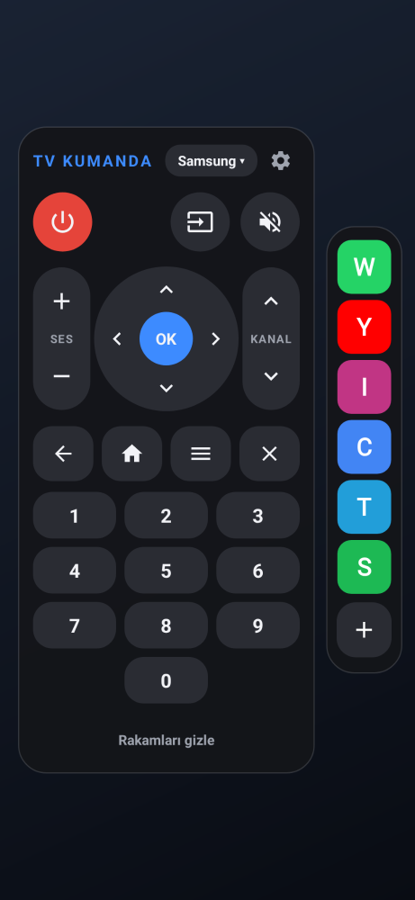

# Kenar Panel

Ekranın kenarında her zaman ince bir çubuk durur. Çubuğa dokununca veya içeri kaydırınca panel anında açılır. Panelde uygulama kısayolları ve kızılötesi **TV kumandası** bulunur. Çubuğun yerini parmağınızla sürükleyerek siz belirlersiniz.

  

 

## Kurulum (APK)

1. [`apk/KenarPanel-1.0.apk`](apk/KenarPanel-1.0.apk) dosyasını telefona indirin (91 KB). Dosyayı açın; Android "bilinmeyen kaynaklardan yükleme" izni isterse verin.
2. Uygulamayı açıp **Başlat**'a dokunun. **Diğer uygulamaların üzerinde göster** iznini açıp geri dönün.
3. **Xiaomi / Redmi / POCO:** İzinler bölümündeki Xiaomi satırına dokunun. **Arka planda çalışırken açılır pencereleri göster** ve **Otomatik başlatma** seçeneklerini açın. Bunlar kapalıysa panelden uygulama açılamaz.

Android 6.0 ve üzeri sürümlerde çalışır. Başka bir uygulama gerekmez.

## Kullanım

- **Paneli açmak:** Kenardaki çubuğa dokunun veya ekranın içine doğru kaydırın.
- **Çubuğu taşımak:** Çubuğu yukarı veya aşağı sürükleyin; yeri kaydedilir. Ayarlardan sol veya sağ kenarı seçebilir, uzunluğunu, kalınlığını ve görünürlüğünü değiştirebilirsiniz. **Konumu kilitle** ile yanlışlıkla kaymasını önleyebilirsiniz.
- **Paneli kapatmak:** Boş alana dokunun veya geri tuşuna basın.
- **Uygulamalar:** Paneldeki simgeye dokununca uygulama açılır ve panel kapanır. **+** veya ayarlardaki **Uygulamaları seç** ile en fazla 12 uygulama seçilir; işaretleme sırası paneldeki sıradır.
- **TV kumandası:**
  - Telefonun üst kenarını TV'ye doğru tutun.
  - Tuşlar: güç, kaynak, sessiz, ses +/−, kanal +/−, yön tuşları ve OK, geri, ana sayfa, menü, çıkış. İsterseniz 0–9 rakam tuşlarını da açabilirsiniz.
  - Ses, kanal ve yön tuşları basılı tutulunca tekrarlar.
  - **Marka:** Samsung, LG, Sony veya Philips. Paneldeki marka etiketine dokununca sıradaki markaya geçer.
  - **Markayı bul:** Ayarlardaki bu düğme her markanın güç kodunu sırayla gönderir; TV kapanınca **Çalıştı**'ya dokunursunuz.

## "Bekleme olmasın" için yapılanlar

- **Panel hazır bekler:** Panel, uygulama simgeleriyle birlikte servis başlarken bir kez hazırlanır ve bellekte tutulur. Açmak yalnızca hazır pencereyi ekrana eklemektir; yükleme ve animasyon beklemesi yoktur.
- **Kaydırma anında açar:** Panel parmak kalkmadan, kaydırma 20 dp'yi geçtiği anda açılır.
- **Tuş dokunduğunuz anda gider:** Kumanda tuşu parmak dokunduğu anda (bırakmayı beklemeden) gönderilir. Gönderme ayrı bir iş parçacığında yapılır, böylece ekran hiç takılmaz.
- **Sistem hareketiyle çakışmaz:** Hareketli gezinmede çubuğun bulunduğu alan sistem "geri" hareketinden hariç tutulur. Böylece içeri kaydırma geri hareketine dönüşmez.

## TV kodları nasıl üretiliyor?

Kızılötesi sinyaller uygulamanın içinde, protokolün kendisinden üretilir:

| Marka | Protokol | Taşıyıcı |
|---|---|---|
| Samsung | Samsung32 (4,5 ms başlık, adres 0x07) | 38 kHz |
| LG | NEC (9 ms başlık, adres 0x04) | 38 kHz |
| Sony | SIRC 12 bit (3 tekrar, 45 ms arayla) | 40 kHz |
| Philips | RC5 (Manchester, 889 µs) | 36 kHz |

Gönderme için Android'in standart `ConsumerIrManager` arayüzü kullanılır. Telefonun desteklemediği bir taşıyıcı frekansı istenirse en yakın desteklenen frekans seçilir.

## Nasıl test edildi?

`./gradlew testReleaseUnitTest` 12 test çalıştırır:

- **`IrTest` (6 test):**
  - Üretilen sinyaller geri çözülüp bilinen kodlarla karşılaştırıldı:
    - LG güç `0x20DF10EF`, ses `0x20DF40BF` / `0x20DFC03F`, sessiz, kaynak, rakamlar.
    - Samsung güç `0xE0E040BF`, ses `0xE0E0E01F` / `0xE0E0D02F`, kanal, kaynak, rakamlar.
    - Sony güç `0xA90`; çerçeveler 3 kez, 45 ms arayla gönderiliyor.
    - Philips RC5'te 14 bit Manchester kodlaması doğru; toggle biti her basışta değişiyor.
  - Tüm tuşların sinyalleri 2 saniye sınırının altında ve "açık" ile başlayıp bitiyor.
  - Taşıyıcı frekansı telefonun aralığına uyduruluyor.
- **`PanelTest` (6 test, Robolectric, gerçek servis):**
  - Çubuk seçilen kenarda duruyor. Sürüklenince yeri değişip kaydediliyor; kilitliyken kıpırdamıyor.
  - Dokunma ve içeri kaydırma paneli aynı dokunuşta açıyor. Geri tuşu ve boş alana dokunma paneli kapatıyor.
  - Seçilen uygulamalar panelde sırayla görünüyor; dokununca açılıyor. Sağ kenarda kartların sırası ters dönüyor.
  - Güç tuşuna dokununca LG güç sinyali anında gönderiliyor. Marka etiketi markayı değiştiriyor. Ses tuşu basılı tutulunca tekrarlıyor ve bırakınca duruyor.
  - Kızılötesi verici yoksa panel bunu yazıyor ve tuşlar kapalı oluyor.
  - Ayarlar ekranı ve uygulama seçici çalışıyor; seçim sırası kaydediliyor.

Android Lint 0 hata verdi. Panel ve ayarlar ekranı çizdirilip kontrol edildi.

**Test edilemeyen:** Bu ortamda gerçek telefon ve TV olmadığı için sinyaller gerçek bir TV'de denenemedi. Kodlar yaygın olarak kullanılan bilinen değerlerdir, ancak bazı TV modelleri farklı kod setleri kullanabilir.

## Bilinen sınırlamalar

- **Kızılötesi verici:** TV kumandası yalnızca kızılötesi vericisi olan telefonlarda çalışır. Birçok Xiaomi, Redmi ve POCO modelinde bu verici vardır; Samsung ve Pixel'in yeni modellerinde yoktur.
- **Markalar:** Şimdilik Samsung, LG, Sony ve Philips var. Vestel, Arçelik/Beko, TCL gibi markalar farklı kodlar kullanabilir. "Markayı bul" ile denenebilir; çalışmazsa bu markalar sonra eklenebilir.
- **Uygulama açma:** Xiaomi telefonlarda "arka planda açılır pencere" izni kapalıysa panelden uygulama açılmaz. Diğer telefonlarda "Diğer uygulamaların üzerinde göster" izni yeterlidir.
- **İmza:** APK debug anahtarıyla imzalıdır. Farklı bir ortamda derlenen sürüm üzerine kurulmazsa önce eskisini kaldırın.

## Kaynaktan derleme

```bash
cd edge-panel
export ANDROID_HOME=/android/sdk/yolu
./gradlew assembleRelease        # app/build/outputs/apk/release/app-release.apk
./gradlew testReleaseUnitTest    # testler (Robolectric)
```

| Dosya | Görev |
|---|---|
| `core/Ir.java` | NEC, Samsung32, Sony SIRC, Philips RC5 sinyal üretimi (saf Java, test edilebilir) |
| `core/Remotes.java` | Markalar ve tuş kodları |
| `OverlayService.java`, `HandleView.java` | Kenardaki çubuk, sürükleme, paneli açma/kapatma |
| `Panel.java`, `PanelRoot.java`, `Remote.java` | Hazır bekleyen panel, uygulama kısayolları, kumanda tuşları ve tekrar |
| `MainActivity.java`, `AppPickerActivity.java` | Ayarlar, marka bulma, uygulama seçimi |
