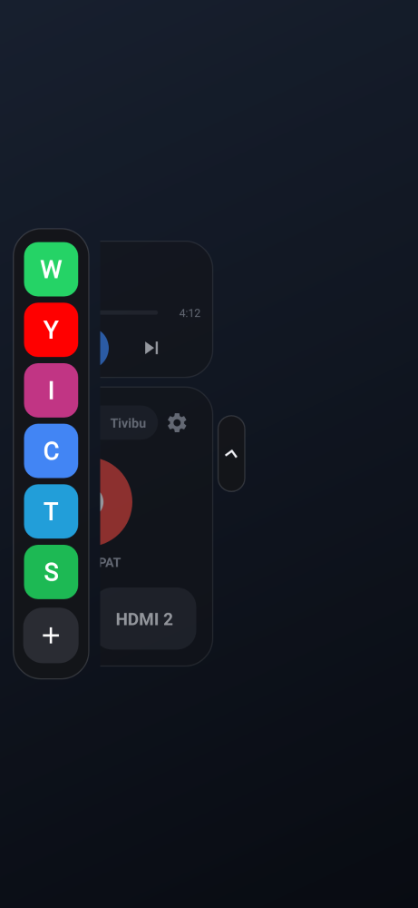
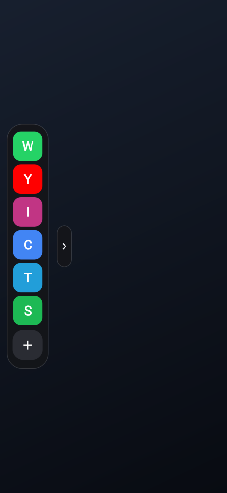
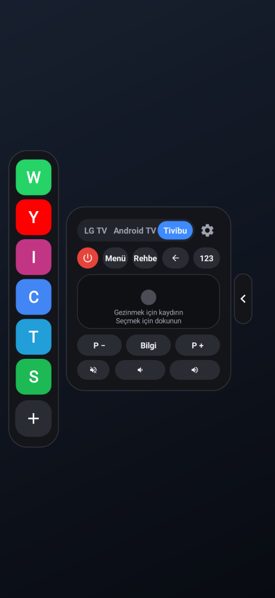
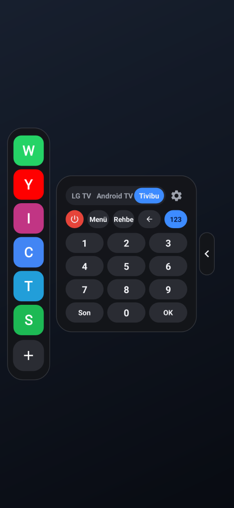
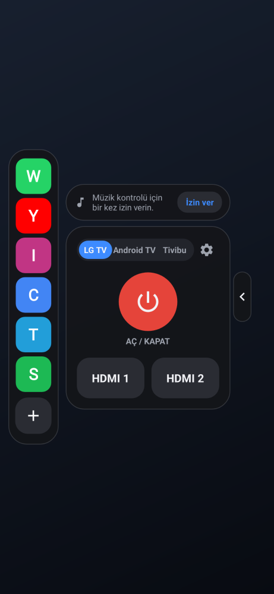
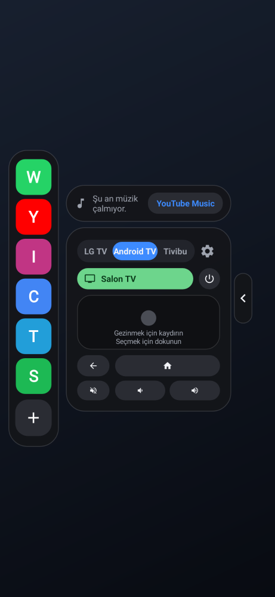
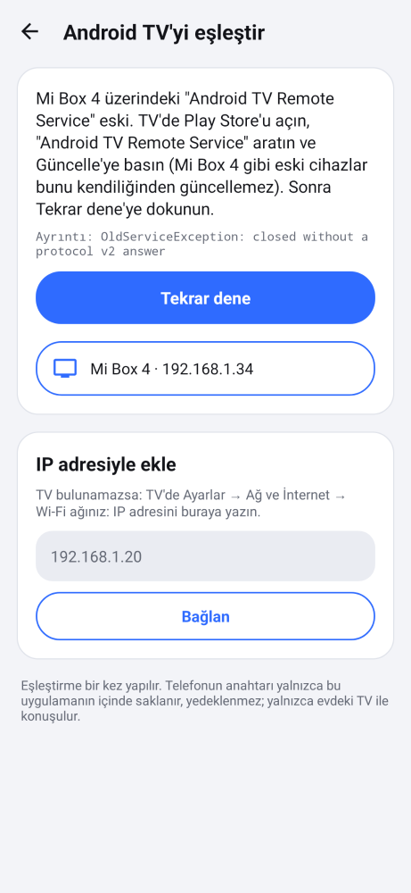
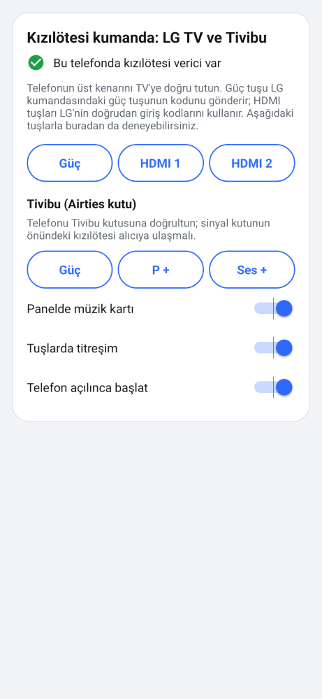

# Kenar Panel

Ekranın kenarında her zaman ince bir çubuk durur. Çubuğu içeri çekince panel parmağınızla birlikte kenardan çıkar; bıraktığınızda yaylanarak açılır. Çubuğun yerini sürükleyerek siz belirlersiniz.

Panelde uygulama kısayolları, bir müzik kartı ve TV kumandası bulunur.

- **Müzik kartı:** YouTube Music gibi bir uygulamada çalan şarkıyı gösterir: kapak, şarkı adı, sanatçı ve ilerleme çubuğu. Önceki, çal/duraklat ve sonraki tuşları da vardır.

TV kumandasının üstündeki seçiciden üçünden biri seçilir:
- **LG TV:** Kızılötesiyle **Güç**, **HDMI 1** ve **HDMI 2**.
- **Android TV:** Wi-Fi üzerinden dokunmatik alan, geri, ana ekran, sessiz, ses −/+ ve güç. Google TV uygulamasındaki kumandanın küçük bir hali gibidir.
- **Tivibu:** Airties Tivibu kutusu için kızılötesi kumanda. Güç, menü, rehber, geri, yön/OK (dokunmatik alan), kanal +/−, bilgi, sessiz ve ses −/+ var. **123** tuşu 0–9 rakamlarını, son kanalı ve OK'u açar.

   

       

   

## Kurulum (APK)

1. [`apk/KenarPanel-1.8.apk`](apk/KenarPanel-1.8.apk) dosyasını telefona indirin (155 KB). Dosyayı açın; Android "bilinmeyen kaynaklardan yükleme" izni isterse verin. Eski sürüm kuruluysa üzerine kurulur.
2. Uygulamayı açıp **Başlat**'a dokunun. **Diğer uygulamaların üzerinde göster** iznini açıp geri dönün.
3. **Müzik kartı için (bir kez):**
   - Paneldeki müzik kartında **İzin ver**'e dokunun. Ayarlarda **Kenar Panel müzik kontrolü** için **Bildirim erişimi**ni açın.
   - Düğme gri ve açılmıyorsa (Android 13 ve sonrası, APK'dan kurulan uygulamalar): Ayarlar → Uygulamalar → Kenar Panel → sağ üstteki **⋮** → **Kısıtlanmış ayarlara izin ver**. Sonra bildirim erişimini açın.
   - Uygulama bildirimleri okumaz ve saklamaz. Bu izin, Android'in hangi uygulamanın müzik çaldığını göstermesi için gereklidir.
4. **Xiaomi / Redmi / POCO:** İzinler bölümündeki Xiaomi satırına dokunun. **Arka planda çalışırken açılır pencereleri göster** ve **Otomatik başlatma** seçeneklerini açın. Bunlar kapalıysa panelden uygulama açılamaz.

Android 6.0 ve üzeri sürümlerde çalışır. Başka bir uygulama gerekmez.

## Kullanım

- **Paneli açmak:**
  - Kenardaki çubuğu içeri çekin; panel parmağınızı takip eder.
  - Yarıdan fazla çekip bırakırsanız açılır. Hızlıca fiskelemek de yeter.
  - Az çeker veya geri çekerseniz kapanır.
  - Çubuğa dokunmak da paneli açar.
- **Kumandayı gizlemek ve açmak:**
  - Kumanda kartının dış kenarındaki **‹ ok**a dokununca kart sağdan sola, uygulama sütununun altına kayarak gizlenir. Ekranda yalnızca uygulama sütunu ve yanındaki **› ok** kalır.
  - **›** oka dokununca kart yaylanarak geri çıkar.
  - Tuşlar kayarken küçülmez, yalnızca uygulama sütununun altına girer.
  - Panel sağ kenardaysa her şey aynalanır.
  - Seçim hatırlanır.
- **Paneli kapatmak:** Boş alana dokunun veya geri tuşuna basın; panel kenara kayarak kapanır.
- **Çubuğu taşımak:** Çubuğu yukarı veya aşağı sürükleyin; yeri kaydedilir. Ayarlardan sol veya sağ kenar, uzunluk, kalınlık ve görünürlük seçilebilir. **Konumu kilitle** ile yanlışlıkla kayması önlenir.
- **Müzik:**
  - Kart, kumandanın hemen üstündedir ve aynı genişliktedir.
  - Kapağa veya şarkı adına dokununca müzik uygulaması açılır.
  - Çubuğu sürükleyip bırakınca şarkıda o noktaya geçilir. Çalarken süre kendiliğinden ilerler.
  - Birden fazla uygulama varsa çalan seçilir; hiçbiri çalmıyorsa YouTube Music seçilir.
  - Hiçbir şey çalmıyorsa kart tek satıra iner; **YouTube Music** düğmesiyle uygulama açılır.
  - Kumandayla birlikte **‹ ok**la gizlenir.
  - Ayarlardaki **Panelde müzik kartı** ile tamamen kapatılabilir.
  - Ekran yeterince uzun değilse (ör. telefon yan tutulduğunda) kart kendiliğinden gizlenir. Kumanda hiçbir zaman sıkışmaz.
- **Uygulamalar:** Simgeye dokununca uygulama açılır. **+** veya ayarlardaki **Uygulamaları seç** ile en fazla 12 uygulama seçilir; işaretleme sırası paneldeki sıradır.
- **LG TV kumandası:** Telefonun üst kenarını TV'ye doğru tutun.
  - **Güç**, LG kumandasındaki güç tuşunun kodunu gönderir: TV açıksa kapanır, kapalıysa açılır.
  - **HDMI 1** ve **HDMI 2**, LG'nin doğrudan giriş kodlarını gönderir.
  - Üç tuş ayarlar ekranından da denenebilir.

## Android TV

- **Seçmek:** Kumandanın üstündeki **LG TV / Android TV** seçicisine dokunun. Kumanda kartının boyutu değişmez; Android TV sayfası LG sayfasıyla aynı alana sığar ve sayfalar kayarak geçer.
- **İlk eşleştirme (bir kez):**
  - Android TV sayfasındaki **Eşleştir**'e (veya ayarlardaki Android TV kartına) dokunun.
  - TV aynı Wi-Fi'da kendiliğinden bulunur; tek TV varsa hemen ona bağlanılır.
  - TV ekranında 6 karakterli bir kod çıkar. Kodu yazınca, düğmeye basmadan eşleşir.
  - Bu kod, Android TV'nin güvenlik gereğidir ve yalnızca ilk seferde sorulur.
  - TV bulunamazsa IP adresiyle de eklenebilir.
- **Sonrası tamamen otomatik:**
  - Panel çekilmeye başladığı anda TV'ye kendiliğinden bağlanılır; hiçbir şey sorulmaz.
  - TV'nin Wi-Fi adresi değişirse TV adıyla yeniden bulunur.
  - Bağlantı, panel kapandıktan 2 dakika sonra kapanır.
  - Bağlanmadan önce basılan tuş, bağlantı kurulur kurulmaz gönderilir.
- **Tuşlar:**
  - Üstte TV adı yazar; bağlıyken yeşil olur, yanında güç tuşu durur.
  - **Dokunmatik alan:** kaydırınca yön tuşları gider, dokununca seçim yapılır. Ortadaki nokta parmağı takip eder.
  - Altta geri, ana ekran, sessiz ve ses −/+ var. Ses tuşları basılı tutulunca tekrarlar.
- **Nasıl çalışır:** Google TV uygulamasının kullandığı Android TV Remote v2 protokolü kullanılır:
  - Eşleştirme 6467 numaralı porttan, kumanda 6466 numaralı porttan, istemci sertifikalı TLS ile yapılır.
  - TV Wi-Fi'da `_androidtvremote2._tcp` olarak bulunur. Servisi eski TV'ler `_androidtvremote._tcp` ile bulunur ve listelenir; böylece güncelleme uyarısı gösterilebilir. TV'nin IPv4 adresi tercih edilir.
  - Telefonun anahtarı (RSA 2048) ve sertifikası ilk eşleştirmede üretilir. Yalnızca uygulamanın kendi klasöründe saklanır ve yedeklenmez.
  - TV'nin sertifikası eşleştirmede kaydedilir; sonra yalnızca o TV kabul edilir.
  - Telefon yalnızca evdeki TV ile konuşur.
- **Bağlanmıyorsa:**

  

  Eşleştirme ekranı sebebi ve ne yapılacağını yazar. Altında küçük bir "Ayrıntı" satırı vardır; sorun sürerse o satırın ekran görüntüsü yeterlidir. **Tekrar dene** düğmesiyle baştan denenir.
  - **"Android TV Remote Service eski":** Mi Box 4 gibi eski cihazlar bu sistem uygulamasını kendiliğinden güncellemez. TV'de Play Store'u açın, "Android TV Remote Service" aratın ve **Güncelle**'ye basın.
  - **"TV eşleştirmeyi reddetti":** TV'de Ayarlar → Uygulamalar → Sistem uygulamaları → Android TV Remote Service → Verileri temizle.
  - **"Yanıt vermiyor":** TV kapalı, başka bir Wi-Fi'da ya da adresi değişmiş olabilir.
- **1.6'da düzeltilen hata:**
  - 1.2–1.5 sürümleri telefonun anahtarını Android'in anahtar deposunda eksik bir izinle üretiyordu.
  - Android TV'ler güvenli bağlantıda RSA-PSS imzası ister. Bu anahtar bu imzayı atamadığı için bağlantı, eşleştirme başlamadan kopuyordu. Hata, Android'in TLS kütüphanesi Conscrypt'te bilinen bir sorundur ([issue 1201](https://github.com/google/conscrypt/issues/1201)).
  - 1.6 bu anahtarı kullanmıyor. Önceki sürümle eşleştirme hiç tamamlanmadığı için yalnızca bir kez eşleştirmek yeterli.

## Animasyonlar

- **Çekerken:** Panel parmağın tam altındadır, gecikme yoktur. Tam açık konumu geçince lastik gibi zorlaşır. Bırakınca yay hareketiyle yerine oturur (yaklaşık %3'lük küçük bir sekme); kapanırken hızlanarak kenara kayar.
- **İçerik sırayla gelir:** Önce kumandanın satırları, sonra uygulama simgeleri; ekrana giriş sırasına göre kayarak ve belirerek gelir. Çubuk, panel geldikçe solar.
- **Tuşlar:** Basınca hafifçe küçülür, bırakınca esneyerek geri döner. Dalga efekti parmağın dokunduğu noktadan yayılır. Kod, parmak dokunduğu anda gönderilir; animasyonu beklemez.
- **Çubuk:** Tutulunca kalınlaşır ve parlaklaşır; bırakınca yaylanarak eski haline döner.
- **Arka plan:** Bulanıklaşmaz; panel geldikçe yalnızca hafifçe kararır.
- **Hız:** Ayarlardan **Hızlı** (varsayılan), **Orta**, **Yavaş** veya **Kapalı** seçilir. Telefonun geliştirici seçeneklerindeki animasyon ölçeği de dikkate alınır.
- **90 FPS:**
  - Animasyonlar her ekran yenilemesinde bir adım ilerler; 90 Hz ekranda saniyede 90 kare oynar.
  - Çekerken ve panel açıkken ekrandan 90 Hz istenir. Ekranda 90 Hz modu yoksa ondan yüksek en düşük mod (ör. 120 Hz) istenir; panel kapanınca normale döner.
  - Ekranın kaç Hz desteklediği ayarlar ekranında yazar.
  - 60 Hz ekranlarda animasyonlar 60 FPS oynar.

## Tivibu

- **Hangi kutu:** Tivibu ve Digiturk Play'in verdiği Airties IPTV kutuları (Air 7100, 7120, 7200, 7200i, 7205). Bu kutuların hepsi aynı kumanda ailesini kullanır.
- **Kullanım:**
  - Seçicide **Tivibu**'ya dokunun.
  - Telefonun üst kenarını kutunun önüne doğrultun.
  - Kutunun kendi kumandası RF modunda olsa bile kutunun kızılötesi alıcısı çalışır; ayar gerekmez.
- **Tuşlar:**
  - Üst sıra: güç (kırmızı), **Menü**, **Rehber**, geri (çıkış), **123**.
  - Ortadaki alan: kaydırınca yön tuşları, dokununca OK.
  - Altta: **P −**, **Bilgi**, **P +**; sessiz, ses −, ses +.
  - **123** ile aynı alanda 0–9 rakamları, **Son** (son kanal) ve **OK** çıkar; kart boyutu değişmez. Panel bir dahaki açılışta yine yön tuşlarıyla açılır.
  - Ses, kanal ve yön tuşları basılı tutulunca, gerçek kumanda gibi her 114 ms'de bir tekrar gönderilir. Kutu bunu tek uzun basış olarak görür.
  - Aynı tuşa iki kez basınca kutu iki basış sayar. Bunun için RC-5'in "toggle" biti her basışta değişir.
- **Ayarlardan deneme:** Ayarlar → **Kızılötesi kumanda** kartında Tivibu için **Güç**, **P +** ve **Ses +** düğmeleri var.



### Tivibu kodları nereden geldi?

- Tivibu'nun kızılötesi kodları hiçbir açık kaynak veritabanında Tivibu adıyla yok. Flipper-IRDB ve probonopd/irdb'de aranıp bulunamadı.
- Kodlar, JP1 evrensel kumanda topluluğunun [hifiremote/deviceupgrades](https://github.com/hifiremote/deviceupgrades) arşivindeki **"Airties Air 7120"** dosyasından alındı. Bu dosya gerçek Airties kumandasından çıkarılmış.
- Protokol: **RC-5**, sistem adresi **27**, **36 kHz**. Dosyadaki her tuş baytının üst 6 biti tersi alınmış komut numarasıdır; bu, JP1'in RC-5 programından doğrulandı. Örneğin rakam 0 = `FC`, 1 = `F8`.
- Uygulamadaki 52 tuşun hepsi bu tabloyla bayt bayt karşılaştırılır (`TivibuTest`).

| Tuş | RC-5 komutu | Tuş | RC-5 komutu |
|---|---|---|---|
| 0–9 | 0–9 | Güç | 19 |
| Kanal + / − | 32 / 33 | Son kanal | 34 |
| Ses + / − | 62 / 61 | Sessiz | 60 |
| Yukarı / Aşağı | 10 / 12 | Sol / Sağ | 13 / 11 |
| OK | 14 | Geri (çıkış) | 15 |
| Menü | 20 | Rehber | 23 |
| Bilgi | 25 | | |

## TV kodları

LG sinyalleri uygulamanın içinde NEC protokolüyle üretilir (LG adresi 0x04, 38 kHz) ve Android'in standart `ConsumerIrManager` arayüzüyle gönderilir.

| Tuş | Kod |
|---|---|
| Güç (aç/kapat) | `0x20DF10EF` |
| HDMI 1 | `0x20DF738C` |
| HDMI 2 | `0x20DF33CC` |

## Nasıl test edildi?

`./gradlew testReleaseUnitTest` 46 test çalıştırır:

- **`IrTest` (3 test):** LG sinyalleri geri çözülüp bilinen kodlarla birebir karşılaştırıldı; NEC çerçevesi ve taşıyıcı frekansı doğru.
- **`TivibuTest` (4 test):**
  - RC-5 sinyalleri, bir alıcının yaptığı gibi 889 µs'lik yarım bitlerle geri çözülüyor. Sistem 0–31, komut 0–127 ve iki toggle değerinin hepsinde başlangıç bitleri, toggle, adres ve komut doğru çıkıyor.
  - Çerçeve yaklaşık 24,9 ms sürüyor; bilinen RC-5 zamanlamasıyla aynı.
  - 52 Tivibu tuşunun hepsi JP1 "Airties Air 7120" tablosundaki baytla aynı. Her tuşun ayrı bir komutu var.
  - Her yeni basışta toggle biti değişiyor; basılı tutunca aynı kalıyor.
- **`PlaybackTest` (2 test):** Çalan şarkının süresi doğru ilerliyor: duraklatınca duruyor, 2× hızda iki kat ilerliyor, şarkı sonunu geçmiyor. Süre yazıları da doğru ("3:07", "1:02:05").
- **`MotionTest` (5 test):** Yay eğrisi, sıralı geliş, çekme sonunda açma/kapama kararı, lastik etkisi ve 90/120 Hz seçimi.
- **`AtvTest` (10 test):**
  - Eşleştirme ve kumanda mesajları bayt bayt doğru.
  - Eşleştirme sırrı, Python'daki açık kaynak referans uygulamanın (androidtvremote2) formülüyle aynı sonucu veriyor.
  - Dokunmatik alanda kaydırma ve dokunma doğru algılanıyor.
  - Sahte bir Android TV'ye gerçek TLS ile bağlanılıyor:
    - Eşleştirme tamamlanıyor; kumanda kanalı açılıyor ve TV'nin ping'lerine cevap veriliyor.
    - Güç, yön ve sessiz tuşları TV'ye ulaşıyor.
    - Yanlış kod reddediliyor; TV'nin tanımadığı telefon "yeniden eşleştir" durumuna düşüyor.
    - Uygulamanın kendi ürettiği anahtar ve sertifika geçerli; kaydedilip geri okunabiliyor. Bu kimlikle Android 9 TV'ler gibi TLS 1.2'de eşleşiliyor ve tuş gönderiliyor.
    - Hatalar ayırt ediliyor: eski TV servisi (Mi Box 4 gibi), TV'nin reddi, kapalı port, ulaşılamayan TV.
- **`ConscryptTest` (2 test):**
  - Aynı eşleştirme ve tuş akışı, Android telefonların kullandığı TLS kütüphanesi Conscrypt ile iki tarafta da çalışıyor.
  - **Mi Box hatası yeniden üretildi:** 1.5'in anahtar deposu anahtarını taklit eden bir anahtar, TLS 1.2'de de 1.3'te de Android'deki hatanın aynısıyla düşüyor ("RSA/ECB/NoPadding" bulunamadı). Yeni kimlik aynı TV'lerle eşleşiyor. TV yalnızca eski imza türünü isteyince eski anahtar da geçiyor; bu da sebebin RSA-PSS olduğunu gösteriyor.
- **`PanelTest` (20 test, Robolectric, gerçek servis, 90 Hz kare aralığıyla):**
  - **‹ ok:**
    - Kumandayı sola kaydırarak gizliyor. Kayarken tuşların boyutu değişmiyor, kart yalnızca sola kayıyor. Sonunda yalnızca ok, uygulama sütununun hemen yanında kalıyor ve **›** oluyor.
    - Okun sekmesi dönmüyor, yalnızca ok dönüyor.
    - Seçim kaydediliyor; **›** ile kart aynı boyutta geri geliyor.
    - Sağ kenarda yön aynalanıyor.
  - Arka plan pencere ayarlarında bulanıklık yok; yalnızca hafif karartma var.
  - Çekme, fiske, yay, lastik etkisi, çubuk büyümesi ve sürükleme çalışıyor; LG tuşları kızılötesi gönderiyor.
  - **Android TV sayfası:**
    - LG ↔ Android TV geçişinde kumanda kartının genişliği ve yüksekliği değişmiyor; eşleştirilmemiş durumda da değişmiyor.
    - Güç, ana ekran ve ses tuşları gidiyor; ses basılı tutulunca tekrarlıyor, bırakınca duruyor.
    - Dokunmatik alanda sağa kaydırma 3 adım gönderiyor, dokunma seçim gönderiyor.
  - **Baştan sona akış:**
    1. Eşleştirme ekranı tek TV'yi görünce kendiliğinden başlıyor.
    2. TV'nin gösterdiği kod yazılınca eşleşme kaydediliyor.
    3. Kumanda sormadan bağlanıyor ve basılan tuş sahte TV'ye ulaşıyor.
    - Bu akış uygulamanın gerçek kimlik koduyla çalışıyor (anahtar üretilip kaydediliyor).
  - **Müzik kartı:**
    - Sahte bir YouTube Music çalarken şarkı adı, sanatçı ve süre görünüyor. Kart kumandanın üstünde ve aynı genişlikte.
    - Süre kendiliğinden ilerliyor.
    - Duraklat/çal, önceki ve sonraki tuşları çalışıyor; duraklatınca süre duruyor.
    - Çubuk sürüklenirken geri kaymıyor, bırakınca şarkıda o noktaya geçiliyor.
    - Şarkı satırı müzik uygulamasını açıyor.
    - İzin yokken tek satırda **İzin ver** çıkıyor ve doğrudan Kenar Panel'in bildirim erişimi ayarını açıyor. Çalan bir şey yoksa **YouTube Music** düğmesi çıkıyor.
    - Kart, kumandayla birlikte **‹ ok**la kayıp gizleniyor. Kayarken tam genişliğini koruyor, kesilmiyor.
    - Ayardan kapatılabiliyor; kumandanın boyutu değişmiyor.
    - Kısa ekranda kart kendiliğinden gizleniyor ve kumanda sıkışmıyor.
  - **Tivibu sayfası:**
    - Kart LG ve Android TV sayfalarıyla aynı genişlikte ve yükseklikte. **123** açıkken de boyut değişmiyor.
    - Bütün tuşlar sahte kızılötesi vericiden geri çözülerek denendi. Güç, menü, rehber, geri, kanal −/+, bilgi, sessiz, ses −/+, 0–9 rakamları, son kanal ve OK doğru komutla, sistem 27 ve 36 kHz'te gidiyor.
    - "105" gibi bir kanal numarası sırayla gidiyor.
    - Aynı tuşa iki basış iki ayrı basış olarak gidiyor.
    - Basılı tutulan ses tuşu her 114 ms'de aynı çerçeveyi gönderiyor ve bırakınca duruyor. Basılı tutulan güç tuşu yalnızca bir kez gidiyor.
    - Dokunmatik alanda sağa kaydırma 3 kez "sağ", dokunma "OK" gönderiyor.
    - Kızılötesi verici olmayan telefonda Tivibu tuşları kapalı.
  - **Eski TV servisi:** Eşleştirme ekranı "Android TV Remote Service eski" diyor, güncelleme adımlarını ve ayrıntıyı gösteriyor. Servis güncellenince **Tekrar dene** ile eşleşiyor.

Android Lint 0 hata verdi. Paneller, çekme anındaki kareler, Android TV ve Tivibu sayfaları (rakam tuşlarıyla birlikte), eşleştirme ve ayarlar ekranı çizdirilip kontrol edildi.

**Test edilemeyenler:**
- Bu ortamda gerçek telefon, LG TV ve Android TV olmadığı için gerçek cihazlarla denenemedi.
- Android TV protokolü, yaygın kullanılan açık kaynak uygulamayla ve sahte TV ile doğrulandı.
- Animasyonların akıcılığı gerçek ekranda görülemedi.
- **Tivibu kodları gerçek kutuda denenemedi.** Kodlar Airties Air 7120 kumandasının yayımlanmış kayıtlarından geliyor ve 7100/7120/7200/7200i aynı kumandayı kullanıyor. Yine de Tivibu kutunuzun yazılımı farklı bir kod bekliyorsa tuşlar çalışmaz (aşağıya bakın).
- Müzik kartı sahte bir müzik çalarla denendi. Gerçek YouTube Music ile Android'in medya oturumları üzerinden çalışır, ama gerçek telefonda denenemedi.

## Bilinen sınırlamalar

- **HDMI tuşları:** HDMI 1/2 kodları LG'nin "doğrudan giriş" kodlarıdır ve normal kumandada yoktur. Çoğu LG TV bu kodları tanır; tanımayan eski modellerde HDMI tuşları çalışmayabilir.
- **Kızılötesi verici:** LG ve Tivibu kumandaları yalnızca kızılötesi vericisi olan telefonlarda çalışır. Birçok Xiaomi, Redmi ve POCO modelinde bu verici vardır. Android TV kumandası Wi-Fi ile çalışır, verici gerekmez.
- **Tivibu:**
  - Telefon kutunun önündeki alıcıyı görmelidir. Kutu dolabın içindeyse veya arkası dönükse sinyal ulaşmaz.
  - Hiçbir tuş çalışmıyorsa kutunuz bu Airties ailesinden değildir. Örneğin Motorola VIP kutularında ve yeni ZTE Android TV kutusunda durum böyledir. Kutunun altındaki etiketteki modeli yazarsanız o kutu eklenebilir.
  - Yeni Tivibu kutusu (ZTE, Android TV) varsa kumanda olarak **Android TV** sayfası Wi-Fi ile kullanılabilir.
- **Müzik kartı:**
  - Bildirim erişimi açılmadan çalışmaz.
  - Kapak, şarkı adı ve süreyi müzik uygulaması verir. Bazı uygulamalar kapak veya süre göndermez; o zaman müzik simgesi görünür ve ilerleme çubuğu gizlenir.
- **Android TV:**
  - Telefon ve TV aynı Wi-Fi'da olmalıdır.
  - İlk eşleştirmedeki kodu TV istediği için bir kez yazmak gerekir.
  - Mikrofonla sesli arama şimdilik yok.
  - TV sıfırlanırsa panel "Yeniden eşleştir" der.
- **90 Hz:** Ekranın 90 Hz veya üzerini desteklemesi gerekir. Bazı telefonlar (ör. Xiaomi'nin "akıllı yenileme hızı" ayarı) uygulama isteğine rağmen ekran hızını kendi belirler.
- **İmza:** APK debug anahtarıyla imzalıdır. Farklı bir ortamda derlenen sürüm üzerine kurulmazsa önce eskisini kaldırın.

## Kaynaktan derleme

```bash
cd edge-panel
export ANDROID_HOME=/android/sdk/yolu
./gradlew assembleRelease        # app/build/outputs/apk/release/app-release.apk
./gradlew testReleaseUnitTest    # testler (Robolectric)
```

| Dosya | Görev |
|---|---|
| `core/Ir.java`, `core/Remotes.java` | NEC ve RC-5 sinyal üretimi, LG güç/HDMI kodları (saf Java) |
| `core/Tivibu.java` | Tivibu (Airties) tuşları, RC-5 toggle biti (saf Java) |
| `core/Motion.java` | Yay eğrisi, sıralı geliş, lastik etkisi, açma kararı, 90 Hz seçimi (saf Java) |
| `Tween.java` | Ekran yenilemesine bağlı animasyon adımları |
| `OverlayService.java`, `HandleView.java` | Çubuk, parmağı takip eden çekme, fiske, 90 Hz isteği |
| `Panel.java`, `PanelRoot.java`, `Remote.java` | Hazır bekleyen panel, ilerleme tabanlı animasyon, tuşlar |
| `atv/Proto.java`, `atv/Messages.java` | Android TV Remote v2 mesajları ve eşleştirme sırrı (saf Java) |
| `atv/Tls.java`, `atv/Pairing.java`, `atv/Session.java` | İstemci sertifikalı TLS, tek seferlik eşleştirme, kumanda kanalı (saf Java) |
| `atv/Touchpad.java`, `TouchpadView.java` | Kaydırma → yön tuşları, dokunma → seçim |
| `AtvIdentity.java`, `AtvFinder.java`, `AtvRemote.java` | Anahtarın saklanması, Wi-Fi'da TV bulma, otomatik bağlanma |
| `PairActivity.java` | Tek seferlik eşleştirme ekranı, hata sebebi ve çözümü |
| `atv/SelfSigned.java`, `atv/Failure.java` | Telefonun anahtarı ve kendinden imzalı sertifikası, hata türleri (saf Java) |
| `Music.java`, `MusicAccess.java`, `core/Playback.java` | Çalan şarkı ve tuşları (medya oturumları), bildirim erişimi, süre hesabı |
| `MainActivity.java`, `AppPickerActivity.java` | Ayarlar, hız seçimi, tuş denemesi, uygulama seçimi |
