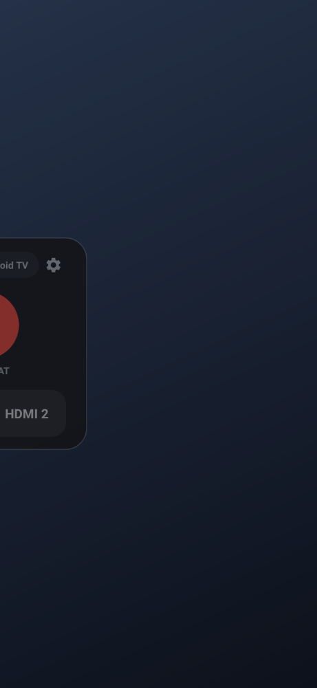
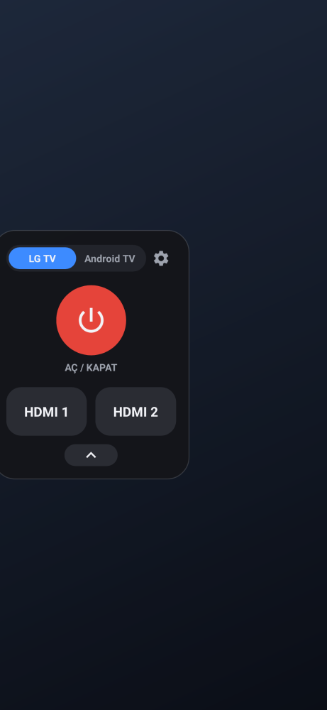
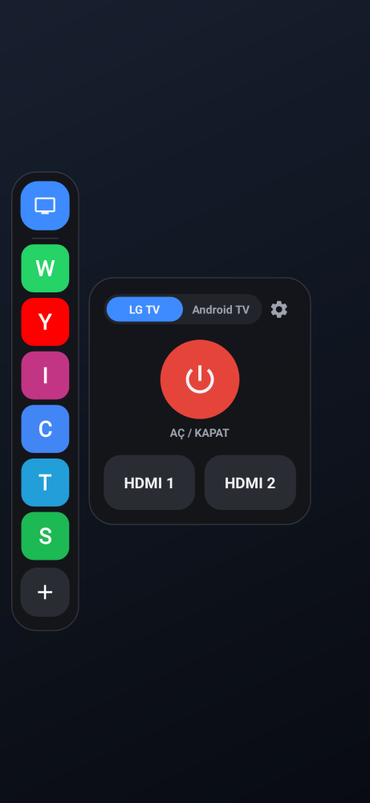
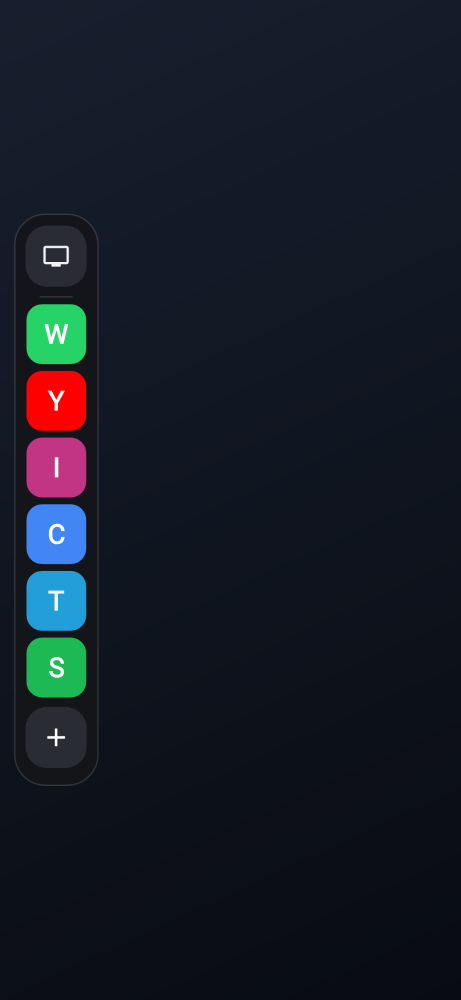
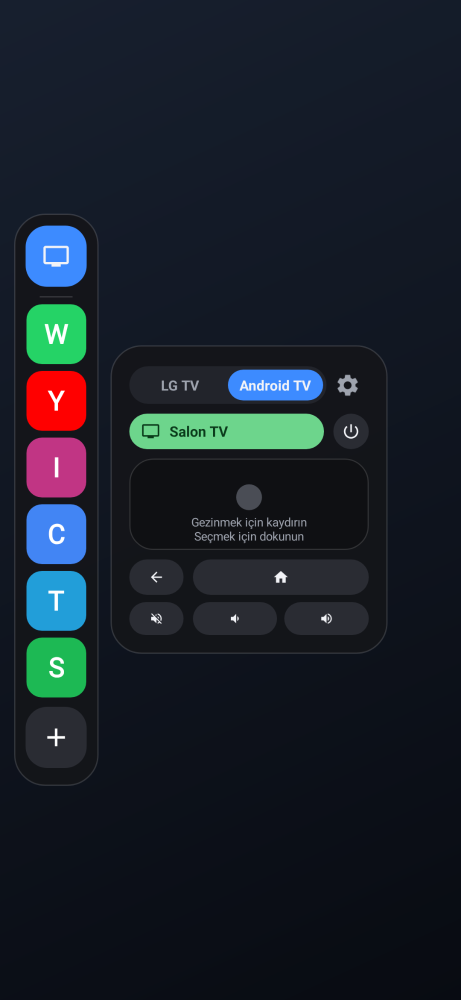
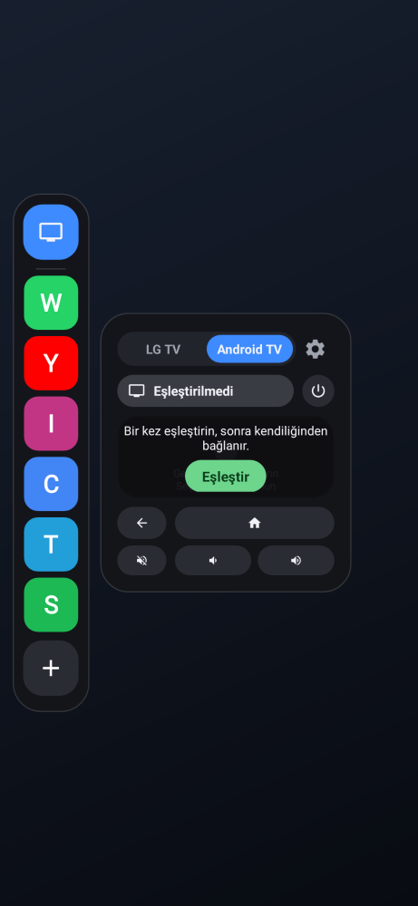
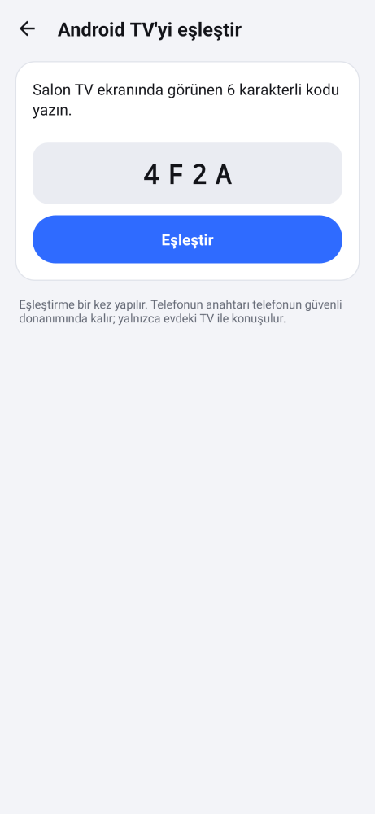
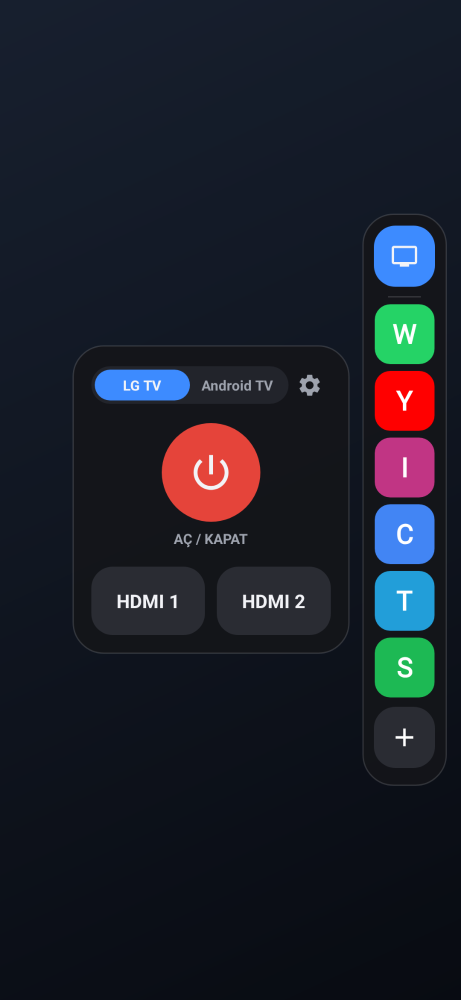
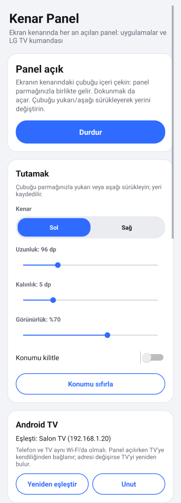
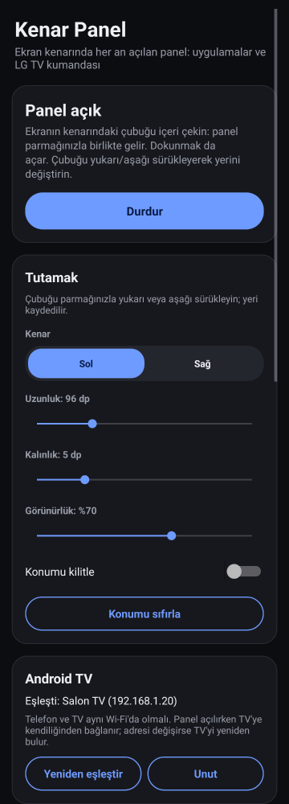

# Kenar Panel

Ekranın kenarında her zaman ince bir çubuk durur. Çubuğu içeri çekince panel parmağınızla birlikte kenardan çıkar; bıraktığınızda yaylanarak açılır. Çubuğun yerini sürükleyerek siz belirlersiniz.

Panelde uygulama kısayolları ve TV kumandası bulunur. Kumandanın üstündeki seçiciden ikisinden biri seçilir:
- **LG TV:** Kızılötesiyle **Güç**, **HDMI 1** ve **HDMI 2**.
- **Android TV:** Wi-Fi üzerinden dokunmatik alan, geri, ana ekran, sessiz, ses −/+ ve güç. Google TV uygulamasındaki kumandanın küçük bir hali gibidir.

   

    

 

## Kurulum (APK)

1. [`apk/KenarPanel-1.3.apk`](apk/KenarPanel-1.3.apk) dosyasını telefona indirin (123 KB). Dosyayı açın; Android "bilinmeyen kaynaklardan yükleme" izni isterse verin. Eski sürüm kuruluysa üzerine kurulur.
2. Uygulamayı açıp **Başlat**'a dokunun. **Diğer uygulamaların üzerinde göster** iznini açıp geri dönün.
3. **Xiaomi / Redmi / POCO:** İzinler bölümündeki Xiaomi satırına dokunun. **Arka planda çalışırken açılır pencereleri göster** ve **Otomatik başlatma** seçeneklerini açın. Bunlar kapalıysa panelden uygulama açılamaz.

Android 6.0 ve üzeri sürümlerde çalışır. Başka bir uygulama gerekmez.

## Kullanım

- **Paneli açmak:**
  - Kenardaki çubuğu içeri çekin; panel parmağınızı takip eder.
  - Yarıdan fazla çekip bırakırsanız açılır. Hızlıca fiskelemek de yeter.
  - Az çeker veya geri çekerseniz kapanır.
  - Çubuğa dokunmak da paneli açar.
- **Kumandayı açıp kapatmak:** Uygulama sütununun en üstündeki **TV düğmesi** kumandayı açar ve kapatır; kumanda açıkken düğme mavidir. Kapalıyken panel yalnızca ince uygulama sütunu kadar yer kaplar. Seçim hatırlanır.
- **Paneli kapatmak:** Boş alana dokunun veya geri tuşuna basın; panel kenara kayarak kapanır.
- **Çubuğu taşımak:** Çubuğu yukarı veya aşağı sürükleyin; yeri kaydedilir. Ayarlardan sol veya sağ kenar, uzunluk, kalınlık ve görünürlük seçilebilir. **Konumu kilitle** ile yanlışlıkla kayması önlenir.
- **Uygulamalar:** Simgeye dokununca uygulama açılır. **+** veya ayarlardaki **Uygulamaları seç** ile en fazla 12 uygulama seçilir; işaretleme sırası paneldeki sıradır.
- **LG TV kumandası:** Telefonun üst kenarını TV'ye doğru tutun.
  - **Güç**, LG kumandasındaki güç tuşunun kodunu gönderir: TV açıksa kapanır, kapalıysa açılır.
  - **HDMI 1** ve **HDMI 2**, LG'nin doğrudan giriş kodlarını gönderir.
  - Üç tuş ayarlar ekranından da denenebilir.

## Android TV

- **Seçmek:** Kumandanın üstündeki **LG TV / Android TV** seçicisine dokunun. Kumanda kartının boyutu değişmez; Android TV sayfası LG sayfasıyla aynı alana sığar ve sayfalar kayarak geçer.
- **İlk eşleştirme (bir kez):**
  - Android TV sayfasındaki **Eşleştir**'e (veya ayarlardaki Android TV kartına) dokunun.
  - TV aynı Wi-Fi'da kendiliğinden bulunur; tek TV varsa hemen ona bağlanılır.
  - TV ekranında 6 karakterli bir kod çıkar. Kodu yazınca, düğmeye basmadan eşleşir.
  - Bu kod, Android TV'nin güvenlik gereğidir ve yalnızca ilk seferde sorulur.
  - TV bulunamazsa IP adresiyle de eklenebilir.
- **Sonrası tamamen otomatik:**
  - Panel çekilmeye başladığı anda TV'ye kendiliğinden bağlanılır; hiçbir şey sorulmaz.
  - TV'nin Wi-Fi adresi değişirse TV adıyla yeniden bulunur.
  - Bağlantı, panel kapandıktan 2 dakika sonra kapanır.
  - Bağlanmadan önce basılan tuş, bağlantı kurulur kurulmaz gönderilir.
- **Tuşlar:**
  - Üstte TV adı yazar; bağlıyken yeşil olur, yanında güç tuşu durur.
  - **Dokunmatik alan:** kaydırınca yön tuşları gider, dokununca seçim yapılır. Ortadaki nokta parmağı takip eder.
  - Altta geri, ana ekran, sessiz ve ses −/+ var. Ses tuşları basılı tutulunca tekrarlar.
- **Nasıl çalışır:** Google TV uygulamasının kullandığı Android TV Remote v2 protokolü kullanılır:
  - Eşleştirme 6467 numaralı porttan, kumanda 6466 numaralı porttan, istemci sertifikalı TLS ile yapılır.
  - TV Wi-Fi'da `_androidtvremote2._tcp` olarak bulunur.
  - Telefonun anahtarı Android'in güvenli anahtar deposunda üretilir ve oradan çıkmaz.
  - TV'nin sertifikası eşleştirmede kaydedilir; sonra yalnızca o TV kabul edilir.
  - Telefon yalnızca evdeki TV ile konuşur.

## Animasyonlar

- **Çekerken:** Panel parmağın tam altındadır, gecikme yoktur. Tam açık konumu geçince lastik gibi zorlaşır. Bırakınca yay hareketiyle yerine oturur (yaklaşık %3'lük küçük bir sekme); kapanırken hızlanarak kenara kayar.
- **İçerik sırayla gelir:** Önce kumandanın satırları, sonra uygulama simgeleri; ekrana giriş sırasına göre kayarak ve belirerek gelir. Çubuk, panel geldikçe solar.
- **Tuşlar:** Basınca hafifçe küçülür, bırakınca esneyerek geri döner. Dalga efekti parmağın dokunduğu noktadan yayılır. Kod, parmak dokunduğu anda gönderilir; animasyonu beklemez.
- **Çubuk:** Tutulunca kalınlaşır ve parlaklaşır; bırakınca yaylanarak eski haline döner.
- **Arka plan:** Bulanıklaşmaz; panel geldikçe yalnızca hafifçe kararır.
- **Hız:** Ayarlardan **Hızlı** (varsayılan), **Orta**, **Yavaş** veya **Kapalı** seçilir. Telefonun geliştirici seçeneklerindeki animasyon ölçeği de dikkate alınır.
- **90 FPS:**
  - Animasyonlar her ekran yenilemesinde bir adım ilerler; 90 Hz ekranda saniyede 90 kare oynar.
  - Çekerken ve panel açıkken ekrandan 90 Hz istenir. Ekranda 90 Hz modu yoksa ondan yüksek en düşük mod (ör. 120 Hz) istenir; panel kapanınca normale döner.
  - Ekranın kaç Hz desteklediği ayarlar ekranında yazar.
  - 60 Hz ekranlarda animasyonlar 60 FPS oynar.

## TV kodları

LG sinyalleri uygulamanın içinde NEC protokolüyle üretilir (LG adresi 0x04, 38 kHz) ve Android'in standart `ConsumerIrManager` arayüzüyle gönderilir.

| Tuş | Kod |
|---|---|
| Güç (aç/kapat) | `0x20DF10EF` |
| HDMI 1 | `0x20DF738C` |
| HDMI 2 | `0x20DF33CC` |

## Nasıl test edildi?

`./gradlew testReleaseUnitTest` 29 test çalıştırır:

- **`IrTest` (3 test):** LG sinyalleri geri çözülüp bilinen kodlarla birebir karşılaştırıldı; NEC çerçevesi ve taşıyıcı frekansı doğru.
- **`MotionTest` (5 test):** Yay eğrisi, sıralı geliş, çekme sonunda açma/kapama kararı, lastik etkisi ve 90/120 Hz seçimi.
- **`AtvTest` (7 test):**
  - Eşleştirme ve kumanda mesajları bayt bayt doğru.
  - Eşleştirme sırrı, Python'daki açık kaynak referans uygulamanın (androidtvremote2) formülüyle aynı sonucu veriyor.
  - Dokunmatik alanda kaydırma ve dokunma doğru algılanıyor.
  - Sahte bir Android TV'ye gerçek TLS ile bağlanılıyor:
    - Eşleştirme tamamlanıyor; kumanda kanalı açılıyor ve TV'nin ping'lerine cevap veriliyor.
    - Güç, yön ve sessiz tuşları TV'ye ulaşıyor.
    - Yanlış kod reddediliyor; TV'nin tanımadığı telefon "yeniden eşleştir" durumuna düşüyor.
- **`ConscryptTest` (1 test):** Aynı eşleştirme ve tuş akışı, Android telefonların kullandığı TLS kütüphanesi Conscrypt ile iki tarafta da çalışıyor.
- **`PanelTest` (13 test, Robolectric, gerçek servis, 90 Hz kare aralığıyla):**
  - TV düğmesi kumandayı kayarak kapatıyor. Panel açık kalıyor ve yalnızca uygulama sütunu kadar yer kaplıyor. Seçim kaydediliyor; panel bir dahaki sefere de kapalı açılıyor. Tekrar dokununca kumanda yaylanarak tam boyuta dönüyor.
  - Arka plan pencere ayarlarında bulanıklık yok; yalnızca hafif karartma var.
  - Çekme, fiske, yay, lastik etkisi, çubuk büyümesi ve sürükleme çalışıyor; LG tuşları kızılötesi gönderiyor.
  - **Android TV sayfası:**
    - LG ↔ Android TV geçişinde kumanda kartının genişliği ve yüksekliği değişmiyor; eşleştirilmemiş durumda da değişmiyor.
    - Güç, ana ekran ve ses tuşları gidiyor; ses basılı tutulunca tekrarlıyor, bırakınca duruyor.
    - Dokunmatik alanda sağa kaydırma 3 adım gönderiyor, dokunma seçim gönderiyor.
  - **Baştan sona akış:**
    1. Eşleştirme ekranı tek TV'yi görünce kendiliğinden başlıyor.
    2. TV'nin gösterdiği kod yazılınca eşleşme kaydediliyor.
    3. Kumanda sormadan bağlanıyor ve basılan tuş sahte TV'ye ulaşıyor.

Android Lint 0 hata verdi. Paneller, çekme anındaki kareler, Android TV sayfası, eşleştirme ve ayarlar ekranı çizdirilip kontrol edildi.

**Test edilemeyenler:**
- Bu ortamda gerçek telefon, LG TV ve Android TV olmadığı için gerçek cihazlarla denenemedi.
- Android TV protokolü, yaygın kullanılan açık kaynak uygulamayla ve sahte TV ile doğrulandı.
- Animasyonların akıcılığı gerçek ekranda görülemedi.

## Bilinen sınırlamalar

- **HDMI tuşları:** HDMI 1/2 kodları LG'nin "doğrudan giriş" kodlarıdır ve normal kumandada yoktur. Çoğu LG TV bu kodları tanır; tanımayan eski modellerde HDMI tuşları çalışmayabilir.
- **Kızılötesi verici:** LG kumandası yalnızca kızılötesi vericisi olan telefonlarda çalışır. Birçok Xiaomi, Redmi ve POCO modelinde bu verici vardır. Android TV kumandası Wi-Fi ile çalışır, verici gerekmez.
- **Android TV:**
  - Telefon ve TV aynı Wi-Fi'da olmalıdır.
  - İlk eşleştirmedeki kodu TV istediği için bir kez yazmak gerekir.
  - Mikrofonla sesli arama şimdilik yok.
  - TV sıfırlanırsa panel "Yeniden eşleştir" der.
- **90 Hz:** Ekranın 90 Hz veya üzerini desteklemesi gerekir. Bazı telefonlar (ör. Xiaomi'nin "akıllı yenileme hızı" ayarı) uygulama isteğine rağmen ekran hızını kendi belirler.
- **İmza:** APK debug anahtarıyla imzalıdır. Farklı bir ortamda derlenen sürüm üzerine kurulmazsa önce eskisini kaldırın.

## Kaynaktan derleme

```bash
cd edge-panel
export ANDROID_HOME=/android/sdk/yolu
./gradlew assembleRelease        # app/build/outputs/apk/release/app-release.apk
./gradlew testReleaseUnitTest    # testler (Robolectric)
```

| Dosya | Görev |
|---|---|
| `core/Ir.java`, `core/Remotes.java` | NEC sinyal üretimi, LG güç/HDMI kodları (saf Java) |
| `core/Motion.java` | Yay eğrisi, sıralı geliş, lastik etkisi, açma kararı, 90 Hz seçimi (saf Java) |
| `Tween.java` | Ekran yenilemesine bağlı animasyon adımları |
| `OverlayService.java`, `HandleView.java` | Çubuk, parmağı takip eden çekme, fiske, 90 Hz isteği |
| `Panel.java`, `PanelRoot.java`, `Remote.java` | Hazır bekleyen panel, ilerleme tabanlı animasyon, tuşlar |
| `atv/Proto.java`, `atv/Messages.java` | Android TV Remote v2 mesajları ve eşleştirme sırrı (saf Java) |
| `atv/Tls.java`, `atv/Pairing.java`, `atv/Session.java` | İstemci sertifikalı TLS, tek seferlik eşleştirme, kumanda kanalı (saf Java) |
| `atv/Touchpad.java`, `TouchpadView.java` | Kaydırma → yön tuşları, dokunma → seçim |
| `AtvIdentity.java`, `AtvFinder.java`, `AtvRemote.java` | Anahtar deposu, Wi-Fi'da TV bulma, otomatik bağlanma |
| `PairActivity.java` | Tek seferlik eşleştirme ekranı |
| `MainActivity.java`, `AppPickerActivity.java` | Ayarlar, hız seçimi, tuş denemesi, uygulama seçimi |
