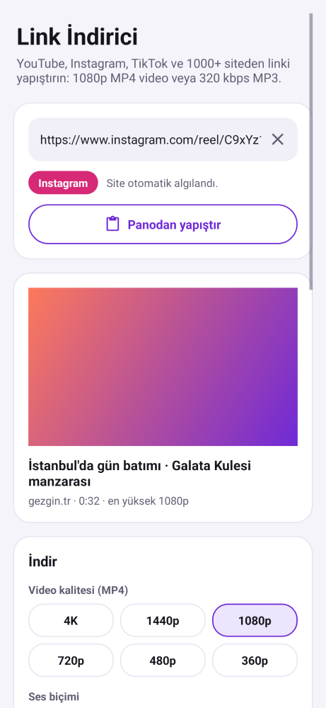
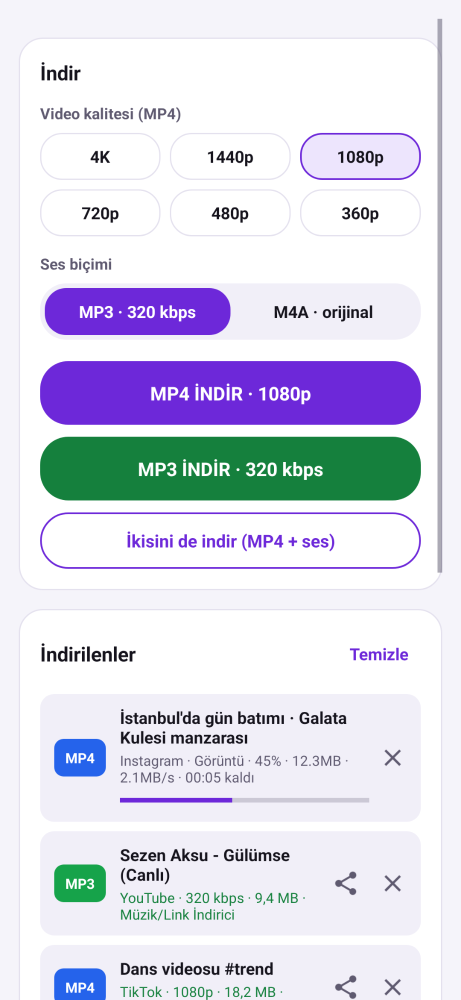
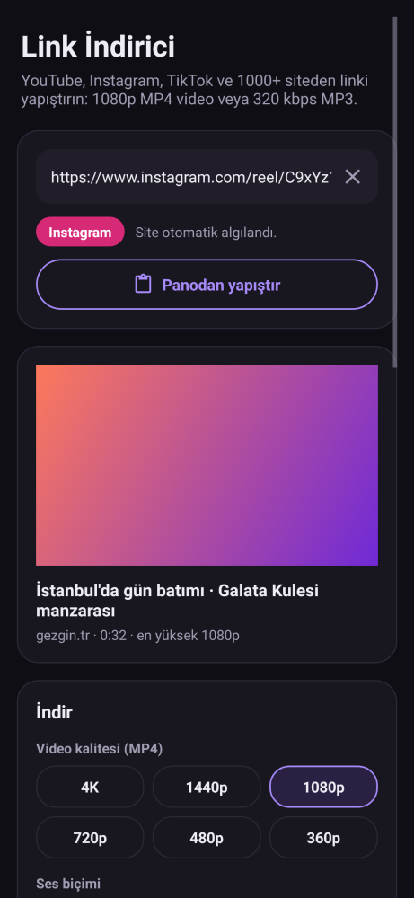

# Link İndirici

Linki yapıştırın veya uygulamadan "Paylaş" ile gönderin. Uygulama linkin **YouTube, Instagram, TikTok** ya da başka bir siteye ait olduğunu otomatik algılar ve **1080p MP4** video veya **320 kbps MP3** ses olarak indirir. Toplam 1000'den fazla site desteklenir (X/Twitter, Facebook, Vimeo, Reddit, SoundCloud, Pinterest, Twitch, Dailymotion…).

  

## Kurulum (APK)

Telefonunuzun işlemcisine uygun dosyayı indirin:

| Dosya | Hangi telefon? |
|---|---|
| [`apk/LinkIndirici-1.0-arm64.apk`](apk/LinkIndirici-1.0-arm64.apk) (54 MB) | **Neredeyse tüm telefonlar** (2017 ve sonrası). Emin değilseniz bunu seçin. |
| [`apk/LinkIndirici-1.0-arm32.apk`](apk/LinkIndirici-1.0-arm32.apk) (48 MB) | Eski / düşük donanımlı 32-bit telefonlar. arm64 sürümü "uygulama yüklenmedi" hatası verirse bunu deneyin. |

Android 7.0 ve üzeri sürümlerde çalışır. Dosyayı açın ve "bilinmeyen kaynaklardan yükleme" izni isterse verin. Uygulama ilk açılışta indirme motorunu birkaç saniyede hazırlar ve en yeni sürüme günceller.

## Kullanım

1. Linki kopyalayıp **Panodan yapıştır**'a dokunun. Alternatif olarak YouTube, Instagram veya TikTok'ta **Paylaş → Link İndirici**'yi seçin.
2. Site otomatik algılanır. Başlık, kapak, süre ve videonun en yüksek kalitesi gösterilir.
3. **MP4 İNDİR · 1080p**, **MP3 İNDİR · 320 kbps** veya **İkisini de indir**'e dokunun.
4. İndirme arka planda sürer; ilerleme bildirimde görünür. Bitince:
   - Videolar **Filmler/Link İndirici** klasörüne kaydedilir ve galeride görünür.
   - Sesler **Müzik/Link İndirici** klasörüne kaydedilir ve müzik uygulamalarında görünür.

### Seçenekler

- **Video kalitesi:** 4K / 1440p / 1080p (varsayılan) / 720p / 480p / 360p. Video seçilen kalitede yoksa, ona en yakın düşük kalite indirilir. Örneğin 1080p seçildiyse ama video en fazla 720p ise 720p iner.
- **H.264 tercihi (varsayılan açık):** Aynı kalitede H.264 varsa o seçilir; bu sayede video WhatsApp'ta ve eski telefonlarda da oynar. Çözünürlük her zaman önce gelir: 1080p yalnızca VP9 olarak varsa VP9 1080p iner, 720p H.264'e düşülmez.
- **Ses:**
  - **MP3 320 kbps:** MP3'ün en yüksek bit hızı. Kapak resmi, başlık ve sanatçı bilgisiyle kaydedilir.
  - **M4A (orijinal):** AAC sesi yeniden kodlamadan kopyalar; kayıpsız kopyadır.
- **Instagram girişi:** Bazı reels videoları yalnızca giriş yapmış kullanıcılara gösterilir. Ayarlar'dan Instagram'a uygulamanın içinde giriş yapabilirsiniz. Oturum çerezleri yalnızca bu telefonda saklanır ve sadece Instagram linkleri için kullanılır. İstediğiniz zaman çıkış yapabilirsiniz.
- **İndirme motoru güncelleme:** Siteler sık değiştiği için motor birkaç günde bir otomatik güncellenir. Ayarlar'dan elle de güncelleyebilirsiniz.

## Nasıl çalışıyor?

- **İndirme motoru:** Uygulama, açık kaynaklı **[yt-dlp](https://github.com/yt-dlp/yt-dlp)** motorunu [youtubedl-android](https://github.com/JunkFood02/youtubedl-android) kütüphanesiyle telefonun içinde çalıştırır. Kütüphane Python'u, YouTube'un artık zorunlu tuttuğu JavaScript motorunu (QuickJS) ve **ffmpeg**'i içerir. Hiçbir sunucuya bağlanılmaz; indirme doğrudan siteden telefona yapılır.
- **Link ve site algılama** (`core/LinkDetector.java`): Paylaşım metninden linki çıkarır (*"Bu videoya göz at! https://vm.tiktok.com/…"*), siteyi algılar ve `igsh`, `si`, `utm_*` gibi takip parametrelerini temizler. Benzer görünen sahte alan adları (`instagram.com.evil.example`) gerçek site sayılmaz.
- **yt-dlp seçenekleri** (`core/Commands.java`):
  - **Video:** `-S res:1080,fps,vcodec:h264,acodec:aac -f bv*+ba/b --merge-output-format mp4`. En iyi görüntü ve en iyi ses ayrı ayrı indirilir, sonra ffmpeg ile MP4'te birleştirilir. YouTube'un 1080p ve üzeri videoları zaten bu şekilde, ayrı parçalar halinde gelir.
  - **MP3:** `-f ba/b -x --audio-format mp3 --audio-quality 320K --embed-thumbnail --embed-metadata`.
- **Hata mesajları** (`core/ErrorHints.java`): yt-dlp hataları anlaşılır Türkçe açıklamalara çevrilir. Örnekler: "YouTube robot sandı", "Instagram girişi gerekiyor", "gizli video", "ülkenizde kullanılamıyor", "çok fazla istek", "internet yok".

## Nasıl test edildi?

**1. Birim testleri:** `./gradlew testReleaseUnitTest` 10 test çalıştırır.
- Uygulamaların gerçek paylaşım metinlerinden link çıkarma
- Sitelerin algılanması (YouTube, Shorts, Instagram, TikTok, X, Facebook, Pinterest, SoundCloud…) ve sahte alan adlarının reddedilmesi
- Takip parametrelerinin temizlenmesi
- Komut seçenekleri
- Gerçek yt-dlp hata mesajlarının sınıflandırılması
- İlerleme satırlarının okunması
- Instagram çerez dosyasının yazılması

**2. yt-dlp ile uçtan uca test** (`tools/`): Gerçek sitelere bağlanmadan, uygulamanın kullandığı *birebir aynı* seçenekler gerçek yt-dlp ve ffmpeg ile denendi.
- `make_test_media.sh` YouTube tarzı akışlar üretir: 1080p H.264, 1080p VP9, 4K VP9, 720p, ayrı AAC/Opus ses, kapak resmi.
- `check_pipeline.py` bu akışları yerel bir sunucudan yt-dlp'ye verip sonucu ffprobe ile ölçer.
- Hem uygulamaya gömülü yt-dlp **2025.11.12** hem de en yeni **2026.10.26** sürümüyle tüm durumlar geçti:

| Durum | Sonuç |
|---|---|
| 1080p seçili | H.264 1920×1080 + AAC, tek MP4, artık dosya yok |
| 1080p'de H.264 yok | VP9 1920×1080 seçildi (720p'ye düşmedi) |
| 4K seçili | VP9 3840×2160 |
| 720p seçili | H.264 1280×720 |
| MP3 | **320 kbps**, kapak (WEBP kapak da JPG'ye çevrilip eklendi), Türkçe başlık ve sanatçı etiketi |
| M4A | Orijinal AAC yeniden kodlanmadan kopyalandı, kapaklı |
| Dosya adı | `Test Şarkı: Ğüş/İ? "klip"` → Android'de geçerli bir ad (Türkçe harfler korunur) |

**3. Lint ve paketleme:** Android Lint 0 hata verdi. APK'ların imzası ve içindeki motor dosyaları (Python, QuickJS, ffmpeg) kontrol edildi.

**Test edilemeyenler:**
- **Gerçek siteler:** Bu bulut ortamından YouTube'a bağlanınca *"robot olmadığınızı doğrulayın"* engeli çıktı. Bu engel veri merkezi IP adreslerinde olur; ev veya mobil internette normalde görülmez. Bu yüzden YouTube, Instagram ve TikTok ile gerçek indirme burada denenemedi.
- **Uygulamanın telefonda çalışması:** Emülatör olmadığı için uygulama bir telefonda da çalıştırılamadı.

## Bilinen sınırlamalar

- **Sitelerin değişmesi:** Siteler indirme yöntemlerini sık değiştirir. Bir site çalışmayı bırakırsa Ayarlar'dan **İndirme motorunu güncelle**'ye dokunun; yt-dlp genellikle birkaç gün içinde düzeltme yayınlar.
- **Instagram:** Instagram bazı içerikleri girişsiz göstermez. Giriş yapsanız bile çok sık indirme hesabınızda geçici kısıtlamaya yol açabilir.
- **İndirilemeyen içerikler:** Gizli hesaplar, canlı yayınlar (bitmeden), DRM korumalı içerikler (Netflix, Spotify, ücretli YouTube filmleri vb.) indirilemez.
- **Ses kalitesi:** "320 kbps MP3" en yüksek MP3 ayarıdır, ama ses kalitesi kaynağın kalitesini geçemez. Platformlar sesi genellikle 128–160 kbps AAC veya Opus olarak verir. Gerçekten kayıpsız kopya için **M4A (orijinal)** seçin.
- **Boyut:** İndirme motoru ve ffmpeg telefonun içinde çalıştığı için APK yaklaşık 50 MB.
- **İmza:** APK debug anahtarıyla imzalıdır. Farklı bir ortamda derlenen yeni bir sürüm eskisinin üzerine kurulmazsa, önce eskisini kaldırın.

**Yasal not:** Yalnızca kendinize ait veya indirme izniniz olan içerikleri indirin. Telif haklarına ve sitelerin kullanım koşullarına uymak kullanıcının sorumluluğundadır.

## Kaynaktan derleme

```bash
cd link-downloader
export ANDROID_HOME=/android/sdk/yolu
./gradlew assembleRelease        # app/build/outputs/apk/release/app-arm64-v8a-release.apk ve app-armeabi-v7a-release.apk
./gradlew testReleaseUnitTest    # birim testleri ve tools/ için argüman dosyaları

# yt-dlp uçtan uca kontrolü (ffmpeg ve yt-dlp gerekir: pip install yt-dlp)
tools/make_test_media.sh
python3 tools/check_pipeline.py "$(which yt-dlp)" app/build/test-out
```

| Dosya | Görev |
|---|---|
| `core/` | Saf Java ve test edilebilir: link/site algılama, yt-dlp seçenekleri, hata sınıflandırma, ilerleme, çerezler |
| `Engine.java` | Gömülü yt-dlp ve ffmpeg: hazırlama, bilgi alma, indirme, iptal, güncelleme |
| `DownloadService.java` | Arka planda sırayla indirme, ilerleme bildirimi, sonucu kaydetme |
| `MediaSaver.java` | Filmler ve Müzik klasörlerine kaydetme (MediaStore) |
| `Downloads.java` / `Item.java` | İndirme listesi ve geçmişi (uygulama kapansa da korunur) |
| `InstagramLoginActivity.java` | Uygulama içi Instagram girişi ve çerezlerin kaydedilmesi |
| `MainActivity.java` | Ana ekran |
