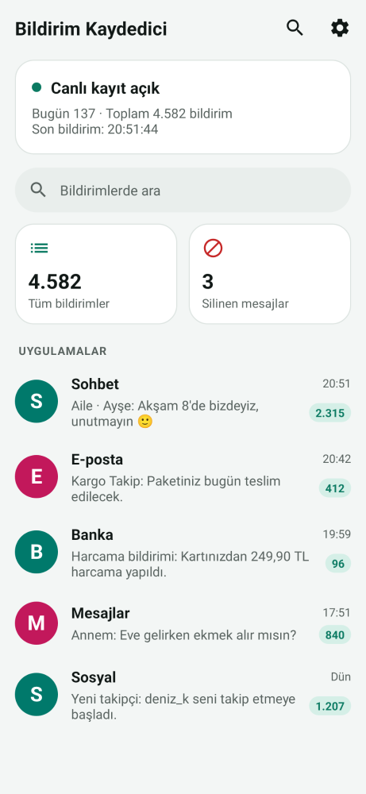
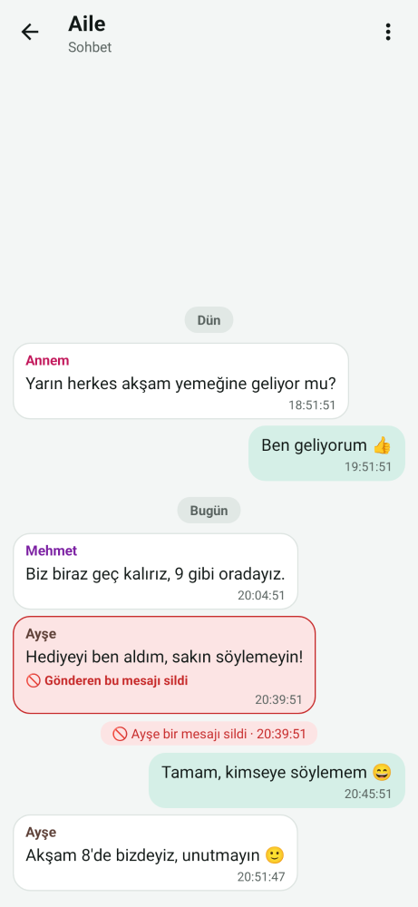
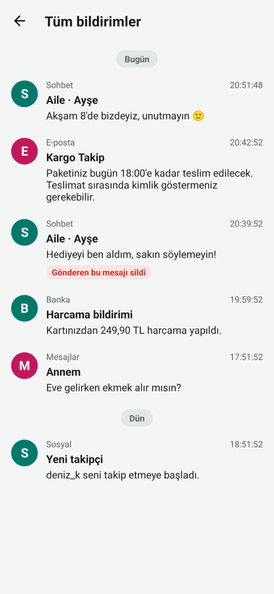
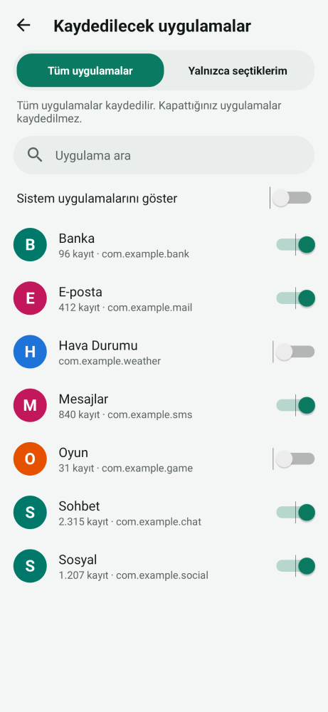
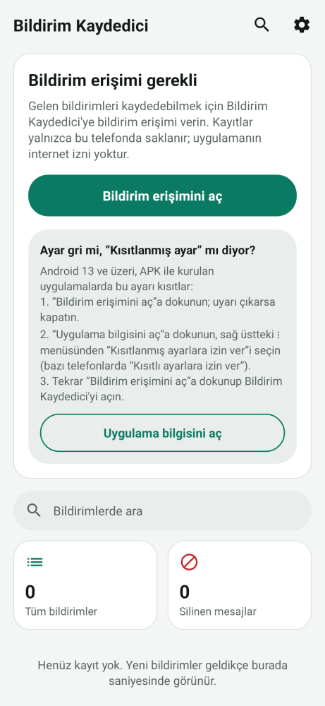
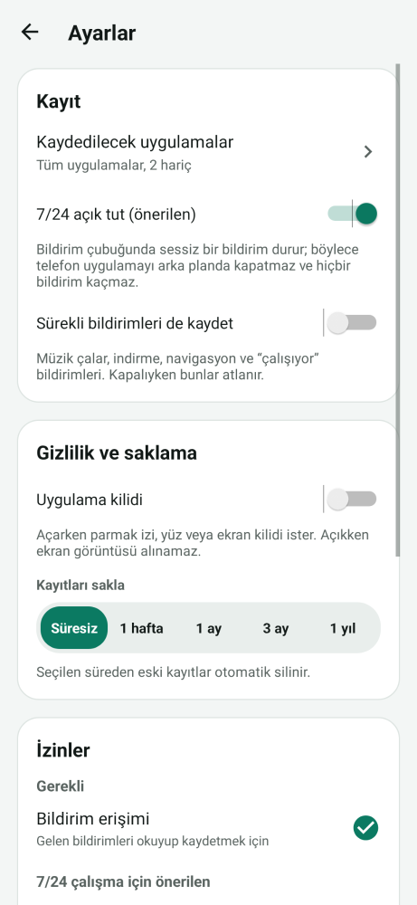
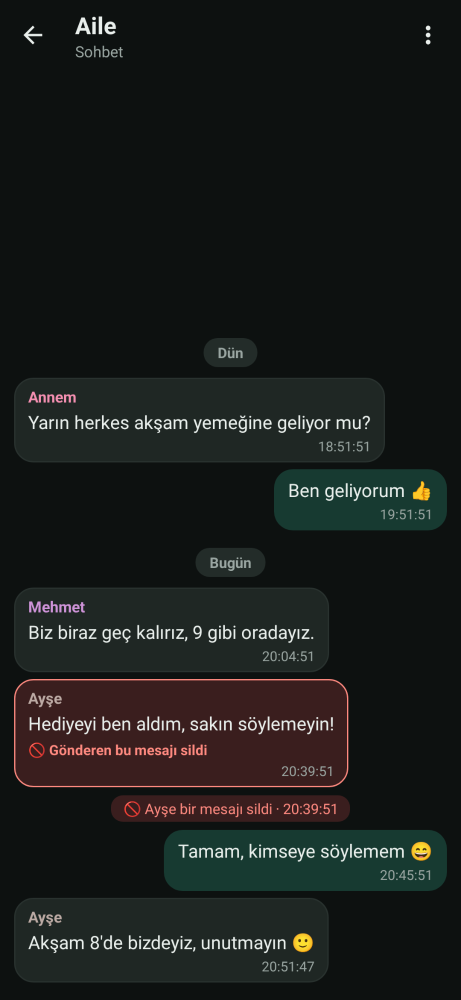

# Bildirim Kaydedici

Telefona gelen her bildirimi **geldiği saniyede** kaydeder ve 7/24 çalışır. Hangi uygulamaların kaydedileceğini siz seçersiniz. Sohbet uygulamalarının mesajları sohbet görünümünde, saniyesiyle birlikte listelenir. Gönderen bir mesajı sonradan silerse, önceden kaydedilen asıl metin saklanmaya devam eder.

   

  

## Kurulum (APK)

1. [`apk/BildirimKaydedici-1.0.apk`](apk/BildirimKaydedici-1.0.apk) dosyasını telefona indirin (114 KB).
2. Dosyayı açın. Android "bilinmeyen kaynaklardan yükleme" izni isterse verin.
3. Uygulamayı açıp **Bildirim erişimini aç**'a dokunun ve listede **Bildirim Kaydedici**'yi açın.

Android 6.0 ve üzeri sürümlerde çalışır.

### Android 13 ve üzeri: "Kısıtlanmış ayar" uyarısı

APK ile kurulan uygulamalarda Android bildirim erişimi ayarını kilitler. Anahtar griyse veya "Kısıtlanmış ayar" uyarısı çıkarsa:

1. Uygulamada **Bildirim erişimini aç**'a dokunun. Uyarı çıkarsa kapatın.
2. **Uygulama bilgisini aç**'a dokunun. Sağ üstteki **⋮** menüsünden **Kısıtlanmış ayarlara izin ver**'i seçin. Bazı telefonlarda bu seçeneğin adı "Kısıtlı ayarlara izin ver"dir.
3. Tekrar **Bildirim erişimini aç**'a dokunup anahtarı açın.

Bu adımlar uygulamanın kurulum ekranında da yazılıdır.

## Özellikler

- **Anında kayıt:** Android her bildirimi geldiği anda uygulamaya iletir. Bildirim aynı anda veritabanına yazılır ve açık olan ekranda hemen görünür. Saatler saniyesiyle gösterilir (`20:51:47`).
- **7/24 çalışma:**
  - Bildirim erişimi açık kaldığı sürece Android dinleyiciyi telefon yeniden başlasa da çalıştırır.
  - **7/24 açık tut** seçeneği varsayılan olarak açıktır. Bildirim çubuğunda sessiz, küçük bir bildirim tutar. Böylece Xiaomi, Huawei ve bazı Samsung telefonlar uygulamayı arka planda kapatamaz.
  - Bağlantı koparsa uygulama kendini yeniden bağlar. Ana ekranda durum "Canlı kayıt açık" veya "Bağlantı bekleniyor" olarak görünür; ikinci durumda **Yeniden bağla** düğmesi çıkar.
- **Uygulama ekle / çıkar:** Ayarlar → **Kaydedilecek uygulamalar**. İki mod vardır:
  - **Tüm uygulamalar:** Kapattıklarınız hariç her şey kaydedilir.
  - **Yalnızca seçtiklerim:** Sadece açtıklarınız kaydedilir.

  Listede arama yapılabilir ve isteğe bağlı olarak sistem uygulamaları da gösterilir. Bir uygulamanın ekranındaki **⋮** menüsünden de "Bu uygulamayı kaydetme" seçilebilir.
- **Sohbet görünümü:**
  - Mesajlaşma uygulamaları (WhatsApp, Telegram, SMS vb.) her yeni mesajda sohbetin son birkaç mesajını tekrar gönderir. Her mesaj yalnızca **bir kez** kaydedilir.
  - Mesajlar uygulamaya ve sohbete göre gruplanır. Grup sohbetlerinde gönderenin adı renkli yazılır; sizin cevaplarınız sağda görünür.
  - "Aile (3 mesaj)" gibi sayaçlar sohbet adından temizlenir.
- **Silinen mesajlar:**
  - WhatsApp gibi uygulamalar silinen bir mesajı bildirimde "Bu mesaj silindi" ile değiştirir. Bildirim Kaydedici önceden kaydettiği asıl metni kırmızıyla işaretler ("Gönderen bu mesajı sildi").
  - Bu mesajlar ana ekrandaki **Silinen mesajlar** bölümünde toplanır.
- **Tüm bildirimler:** Normal bildirimler de kaydedilir: başlık, metin, genişletilmiş metin ve çok satırlı (gelen kutusu) bildirimler. Zaman akışı en yeniden eskiye doğru, gün başlıklarıyla ("Bugün", "Dün", tarih) gösterilir.
- **Arama:** Uygulama adı, kişi, sohbet ve mesaj metninde arar. Büyük/küçük harf ve Türkçe harf farkı yok sayılır; "sukru isik" yazınca "ŞÜKRÜ IŞIK" bulunur.
- **Kayıt işlemleri:** Bir kayda dokununca tam metin açılır. Buradan **Kopyala**, **Paylaş**, **Sohbet**'e git ve **Sil** seçenekleri kullanılabilir. Sohbeti metin olarak paylaşabilir, bir sohbetin veya uygulamanın tüm kayıtlarını silebilirsiniz.
- **Gereksiz kayıt yok:**
  - Grup özetleri ("3 sohbetten 5 mesaj") kaydedilmez.
  - Aynı bildirim 10 dakika içinde tekrar gönderilirse yeniden kaydedilmez.
  - Müzik, indirme ve navigasyon gibi sürekli bildirimler atlanır. İsterseniz ayarlardan bunları da kaydedebilirsiniz.
- **Gizlilik:**
  - Uygulamanın **internet izni yoktur**; kayıtlar telefondan dışarı çıkamaz. Yedekleme de kapalıdır.
  - İsteğe bağlı **uygulama kilidi** vardır (parmak izi, yüz veya ekran kilidi). Kilit açıkken ekran görüntüsü alınamaz ve son uygulamalar ekranında içerik gizlenir.
- **Saklama süresi:** Kayıtlar süresiz, 1 hafta, 1 ay, 3 ay veya 1 yıl saklanabilir. Seçilen süreden eski kayıtlar otomatik silinir.
- **Dışa aktarma:** Tüm kayıtlar **CSV** olarak dışa aktarılabilir. Dosya Excel'de Türkçe karakterlerle doğru açılır.
- **İzin durumu:** Bildirim erişimi, bildirim gösterme, pil optimizasyonu ve "kullanılmıyorsa duraklat" ayarları ✓ veya ⚠ olarak gösterilir. Bir satıra dokunmak ilgili ayar ekranını açar. Xiaomi telefonlarda otomatik başlatma için de hatırlatma çıkar.
- Açık ve koyu tema; Türkçe ve İngilizce dil desteği.

## Nasıl çalışıyor?

- **Dinleme:** Android'in `NotificationListenerService` arayüzü kullanılır. Bildirim erişimi açıldığında uygulama ayrıca bildirim çubuğunda o an duran bildirimleri de kaydeder.
- **Mesajları ayırma:** Sohbet bildirimleri (`MessagingStyle`) mesaj mesaj okunur. Her mesajın gönderen, metin ve kendi zaman damgasından bir parmak izi (SHA-1) çıkarılır. Aynı mesaj sonraki güncellemede tekrar gelse de ikinci kez yazılmaz.
- **Silinen mesajı bulma:** "Bu mesaj silindi" metni, aynı sohbet, aynı gönderen ve aynı zaman damgasıyla gelirse, o damgadaki kayıtlı asıl mesaj "silindi" olarak işaretlenir.
- **Depolama:** Kayıtlar telefondaki SQLite veritabanında tutulur. Veritabanı WAL modunda çalışır; böylece ekranlar okurken yeni bildirimler beklemeden yazılır. Yazma işlemi ayrı bir iş parçacığında, geliş sırasıyla yapılır.
- **Uygulama listesi:** Bildirim gönderen her uygulamanın adını ve simgesini gösterebilmek için `QUERY_ALL_PACKAGES` izni kullanılır. Uygulama Play Store'da değil, APK olarak dağıtıldığı için bu izin sorun değildir.
- **Arka plan servisi:** 7/24 modu bir ön plan servisidir. Android 14+ için türü "özel kullanım" (specialUse) olarak tanımlıdır.

## Nasıl test edildi?

`./gradlew testReleaseUnitTest` 25 test çalıştırır:

- **`CoreTest` (8 test):** "Bu mesaj silindi" algılama, sohbet adı temizleme, uygulama filtresi, parmak izi, Türkçe harf katlama, saat/gün başlıkları ve CSV (Excel için BOM, tırnak ve satır sonu).
- **`PipelineTest` (11 test, Robolectric):** Gerçek `Notification` nesneleri dinleyici servisine gönderilip SQLite'a yazılıyor:
  - Sohbet bildirimi üç kez güncellenince 3 mesaj sırayla ve birer kez kaydediliyor. Her mesajın kendi saati korunuyor; sizin cevabınız "Siz" olarak kaydediliyor.
  - Grup sohbetinde gönderen adları ve "(2 mesaj)" sayacından temizlenmiş sohbet adı doğru kaydediliyor.
  - Silinen mesaj: asıl metin "silindi" olarak işaretleniyor ve Silinen mesajlar'da görünüyor. Aslı görülmemiş "silindi" bildirimleri de listeleniyor.
  - Grup özetleri, müzik çalar ve indirme bildirimleri atlanıyor. Ayar açılınca sürekli bildirimler kaydediliyor.
  - Genişletilmiş metin ve gelen kutusu satırları kaydediliyor. Aynı bildirim 1 dakika sonra tekrar gelince kopya oluşmuyor; 11 dakika sonra gelince yeni kayıt açılıyor.
  - "Tüm uygulamalar" ve "Yalnızca seçtiklerim" modları doğru çalışıyor; uygulama kendi bildirimlerini kaydetmiyor.
  - Arama: "sukru isik" ile "ŞÜKRÜ IŞIK" bulunuyor; `%` ve `_` joker karakter gibi davranmıyor.
  - Saklama süresi eski kayıtları siliyor. Silme ve dışa aktarma doğru çalışıyor.
  - Bildirim erişimi açıldığında, o an bildirim çubuğunda duran bildirimler de kaydediliyor.
- **`ScreensTest` (6 test, Robolectric):**
  - Erişim yokken kurulum kartı görünüyor ve doğru ayar ekranı açılıyor.
  - Ana ekran uygulamaları en yeniden eskiye listeliyor. Yeni bildirim gelince ekran kapanıp açılmadan güncelleniyor.
  - Sohbet ekranında gün başlığı, baloncuklar ve silinen mesaj gösteriliyor.
  - Arama yazarken sonuç veriyor.
  - Uygulama listesinde anahtarlar kaydı açıp kapatıyor.
  - Ayarlar ve diğer ekranlar açılıyor.

Android Lint 0 hata verdi. Tüm ekranlar açık ve koyu temada çizdirilip kontrol edildi (yukarıdaki görüntüler).

**Test edilemeyen:** Bu ortamda emülatör olmadığı için uygulama gerçek bir telefonda çalıştırılamadı. WhatsApp ve benzeri uygulamalarla gerçek kullanım da denenemedi.

## Bilinen sınırlamalar

- **Yalnızca bildirimde görünen kaydedilir:**
  - Sohbet o an açıksa, sessize alınmışsa veya uygulama bildirim göstermiyorsa kayıt da olmaz.
  - Fotoğraf, video ve sesli mesajların kendisi kaydedilmez; yalnızca bildirimdeki metin ("📷 Fotoğraf" gibi) kaydedilir.
  - Uzun mesajlar, uygulamanın bildirimde gösterdiği kadarıyla kaydedilir.
- **Silinen mesajlar:** Bu özellik, uygulama silinen mesajı bildirimde "Bu mesaj silindi" ile değiştirdiğinde çalışır (ör. WhatsApp). Telegram gibi silinen mesajı bildirimden tamamen kaldıran uygulamalarda asıl mesaj kayıtlı kalır, ancak "silindi" olarak işaretlenemez.
- **Xiaomi / HyperOS:** Uygulamaya **Otomatik başlatma** izni verin ve pil tasarrufunda **Kısıtlama yok** seçin. Ayarlar ekranındaki Xiaomi satırı ilgili ekranı açar. Diğer markalarda da pil optimizasyonunu kapatmanız önerilir.
- **İmza:** APK debug anahtarıyla imzalıdır. Farklı bir ortamda derlenen bir sürüm eskisinin üzerine kurulmazsa, önce **CSV olarak dışa aktarın**, sonra eskisini kaldırın.

## Kaynaktan derleme

```bash
cd notification-saver
export ANDROID_HOME=/android/sdk/yolu
./gradlew assembleRelease        # app/build/outputs/apk/release/app-release.apk
./gradlew testReleaseUnitTest    # testler (Robolectric)
```

| Dosya | Görev |
|---|---|
| `core/Rules.java`, `core/Formats.java`, `core/Capture.java` | Silindi algılama, filtre, parmak izi, Türkçe arama, saat ve CSV (saf Java, test edilebilir) |
| `ListenerService.java`, `Parser.java` | Bildirimleri dinleme ve okuma (sohbet mesajları, genişletilmiş metin) |
| `Db.java`, `Store.java` | SQLite arşivi, kopya engelleme, silinen mesaj eşleştirme, arka planda yazma |
| `KeepAliveService.java`, `BootReceiver.java` | 7/24 modu, açılışta başlatma |
| `MainActivity.java`, `BrowseActivity.java`, `Rows.java`, `Dialogs.java` | Ana ekran, sohbetler, zaman akışı, arama, silinen mesajlar |
| `AppsActivity.java`, `SettingsActivity.java`, `Prefs.java` | Uygulama seçimi, ayarlar, dışa aktarma |
| `BaseActivity.java`, `Perms.java` | Uygulama kilidi, kenardan kenara ekran, izinler |
