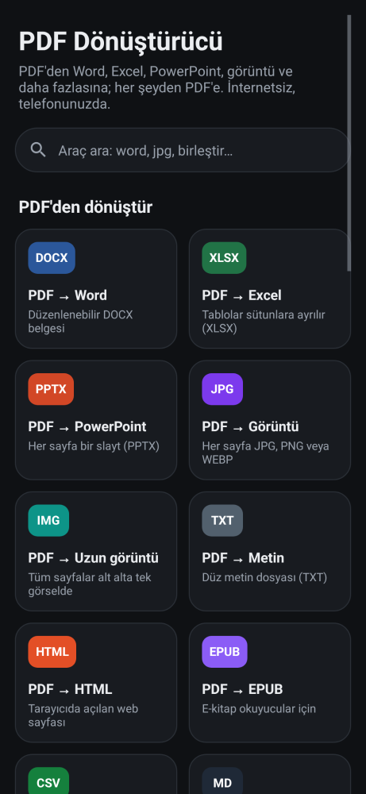
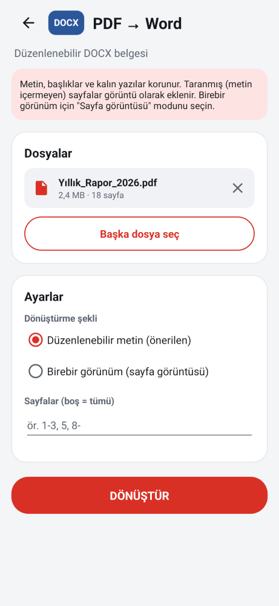
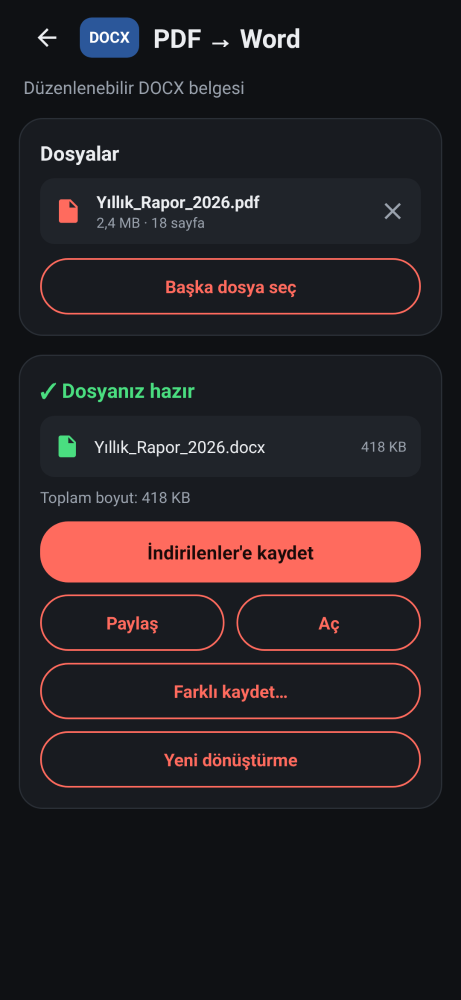

# PDF Dönüştürücü

İnternet gerektirmeyen, hepsi bir arada PDF uygulaması. PDF'i Word, Excel, PowerPoint, görüntü, metin, HTML, EPUB ve başka formatlara çevirir. Word, Excel, PowerPoint, görüntü ve metin dosyalarını PDF'e çevirir. Birleştirme, bölme, sıkıştırma ve şifreleme gibi araçlar da içerir. Tüm işlemler telefonda yapılır; dosyalar hiçbir sunucuya gönderilmez.

  

## Kurulum (APK)

1. [`apk/PdfDonusturucu-1.0.apk`](apk/PdfDonusturucu-1.0.apk) dosyasını telefona indirin (8,6 MB).
2. Dosyayı açın. Android "bilinmeyen kaynaklardan yükleme" izni isterse verin.
3. **Yükle**'ye dokunun.

Android 6.0 ve üzeri sürümlerde çalışır.

## 32 araç

### PDF'den dönüştür

| Araç | Çıktı | Açıklama |
|---|---|---|
| PDF → Word | DOCX | Düzenlenebilir metin. Başlıklar, kalın ve italik yazılar korunur, satırlar paragraflara birleştirilir. Taranmış sayfalar görüntü olarak eklenir. *Birebir görünüm* modu her sayfayı görüntü olarak koyar. |
| PDF → Excel | XLSX | Metnin konumuna göre sütunlar algılanır. Her PDF sayfası ayrı bir çalışma sayfası olur ya da hepsi tek sayfada toplanır. Sayılar gerçek sayı olarak yazılır. |
| PDF → PowerPoint | PPTX | Her sayfa bir slayt olur. Slayt boyutu sayfa boyutuyla aynıdır. |
| PDF → Görüntü | JPG / PNG / WEBP | Çözünürlük 72–300 DPI arasında seçilebilir. İsteğe bağlı olarak tek ZIP dosyasında toplanır. |
| PDF → Uzun görüntü | JPG / PNG | Tüm sayfalar alt alta tek görsel olur (sohbet uygulamalarında paylaşmak için). |
| PDF → Metin | TXT | |
| PDF → HTML | HTML | Başlıklı, koyu temayı destekleyen bir web sayfası. |
| PDF → EPUB | EPUB 3 | E-kitap okuyucular için. |
| PDF → CSV | CSV | Sütunlu veri. UTF-8 BOM ile yazılır, ayırıcı `;` veya `,` olabilir. |
| PDF → Markdown | MD | |
| PDF → RTF | RTF | |
| Görselleri çıkar | JPG / PNG | PDF içindeki resimleri kaydeder. JPEG resimler kayıpsız, orijinal haliyle çıkarılır. |

### PDF'e dönüştür

| Araç | Girdi | Açıklama |
|---|---|---|
| Görüntü → PDF | JPG, PNG, WEBP, HEIC… | Birden çok görüntüyü istediğiniz sırada birleştirir. JPEG'ler yeniden sıkıştırılmadan gömülür. Fotoğrafın yönü (EXIF) uygulanır. |
| Word → PDF | DOCX | Başlıklar, kalın/italik/altı çizili yazılar, renkler, madde işaretli ve numaralı listeler, tablolar, resimler ve sayfa sonları aktarılır. |
| Excel → PDF | XLSX | Tüm görünür sayfalar aktarılır. Tarihler ve sayılar biçimlendirilir. Uzun tablolarda başlık satırı her sayfada tekrarlanır. |
| PowerPoint → PDF | PPTX | Metin kutuları konumlarıyla, yer tutucular, resimler, gruplar, tablolar ve arka plan renkleri aktarılır. |
| Metin / HTML / Markdown / CSV → PDF | TXT, HTML, MD, CSV/TSV | Sayfa boyutu, kenar boşluğu ve yazı boyutu seçilebilir. |
| Herhangi bir belge → PDF | hepsi | Dosya türü otomatik algılanır. JSON ve XML de desteklenir. |

### PDF araçları

PDF birleştir · PDF böl (her sayfa / her N sayfa / aralıklar) · Sayfa seç ve sırala (`3,1,2` gibi; `10-1` ters sırayla) · Sayfa sil · Sayfa döndür · PDF sıkıştır (resimler yeniden sıkıştırılır, metin net kalır) · Şifre koy (AES-256; yazdırma, kopyalama ve düzenleme izinleri ayrı ayrı seçilir) · Şifre kaldır · Filigran ekle (çapraz veya yatay; saydamlık ve renk seçilir) · Sayfa numarası ekle · Siyah-beyaz yap / düzleştir

### Kullanım kolaylıkları

- **Şifreli PDF'ler:** Tüm araçlarda çalışır; uygulama şifreyi sorar.
- **Sayfa aralığı:** Çoğu araç yalnızca seçtiğiniz sayfalarla çalışabilir (`1-3, 5, 8-`).
- **Başka uygulamalardan dosya:** "Paylaş" veya "Birlikte aç" ile gelen dosya için yalnızca uygun araçlar gösterilir.
- **Arka planda çalışma:** Ekran kapansa da dönüştürme devam eder; ilerleme bildirimde görünür.
- **Sonucu kullanma:** Sonucu **İndirilenler/PDF Dönüştürücü** klasörüne kaydedebilir, paylaşabilir, açabilir veya istediğiniz yere kaydedebilirsiniz.
- **Ayarların hatırlanması:** Son seçtiğiniz ayarlar her araç için ayrı ayrı hatırlanır.
- **Arayüz:** Türkçe arayüz (İngilizce yedeğiyle), açık ve koyu tema.

## Bilinen sınırlamalar

- **Taranmış PDF'ler:** Metin tanıma (OCR) yok. Taranmış belgelerde seçilebilir metin yoksa Excel, CSV ve metin çıktıları boş kalır; uygulama bunu bir uyarıyla bildirir. *PDF → Word* bu sayfaları görüntü olarak ekler.
- **PDF → Word / Excel:** Çok sütunlu sayfa düzenleri, kenar kutuları ve karmaşık tablolar basitleştirilir. Amaç, metni düzenlenebilir hale getirmektir.
- **Office → PDF:** Microsoft Office'in birebir kopyası değildir. Grafikler, SmartArt, şekiller, üstbilgi/altbilgi ve özel yazı tipleri aktarılmaz. Eski `.doc`, `.xls` ve `.ppt` dosyaları desteklenmez; uygulama bunları yeni formatta kaydetmenizi ister.
- **Siyah-beyaz / düzleştir:** Sayfalar görüntüye çevrildiği için çıktıda metin seçilemez.
- **İmza:** APK debug anahtarıyla imzalıdır. Farklı bir ortamda derlenmiş bir sürüm, eskisinin üzerine kurulmayabilir. Bu durumda önce eski sürümü kaldırın.

## Nasıl test edildi?

`./gradlew testReleaseUnitTest` 21 test çalıştırır.

- **`CoreTest` (15 test), saf Java:**
  - Python kütüphaneleriyle (python-docx, openpyxl, python-pptx) üretilmiş gerçek Word, Excel ve PowerPoint dosyaları okunuyor: başlıklar, listeler, tablolar, resimler, tarihler, yer tutucular, gruplar.
  - Uygulamanın yazdığı DOCX, XLSX, PPTX ve EPUB dosyaları geri okunuyor.
  - Sayfa aralığı ayrıştırma, CSV, sayı algılama, paragraf birleştirme ve sütun hizalama kontrol ediliyor.
- **`PdfToolsTest` (6 test), Robolectric ile gerçek PDFBox kullanılarak:**
  - Birleştirme, bölme (her sayfa, aralık, her N sayfa ve ZIP), sayfa seçme, sıralama, silme ve döndürme.
  - AES-256 şifreleme ve izinler; yanlış şifrenin şifre sorusuna dönüşmesi; şifre kaldırma.
  - Türkçe karakterli filigran (emoji yerine `?` yazılıyor, uygulama çökmüyor) ve sayfa numaraları.
  - PDF'ten metin, HTML, Markdown, CSV, Excel, Word, RTF ve EPUB üretimi.
  - Görsel çıkarma, sıkıştırma ve görüntüden PDF oluşturma.

Üretilen dosyalar ayrıca bağımsız araçlarla açıldı:

- **LibreOffice:** DOCX, XLSX, PPTX ve RTF dosyaları PDF'e çevrildi; sayfa sayıları ve Türkçe metin doğru çıktı.
- **Poppler (`pdfinfo`, `pdftotext`):** Şifreli çıktı "AES-256, copy:no, print:yes" olarak raporlandı; sayfa numaraları ve filigran okundu.
- **Python ofis kütüphaneleri:** Word başlık stilleri, Excel sayı hücreleri ve PowerPoint slaytları beklendiği gibi açıldı.

Bu ortamda emülatör olmadığı için Android'in sayfa çizme bileşenleri (`PdfRenderer`, `PdfDocument`) çalıştırılarak test edilemedi. Bunlara dayanan araçlar derleniyor ve Lint denetiminden hatasız geçiyor:

- PDF → Görüntü, Uzun görüntü, PowerPoint ve Word'ün "Sayfa görüntüsü" modu
- Siyah-beyaz yap
- Word, Excel, PowerPoint, metin ve HTML → PDF

## Kaynaktan derleme

```bash
cd pdf-converter
export ANDROID_HOME=/android/sdk/yolu
./gradlew assembleRelease          # app/build/outputs/apk/release/app-release.apk
./gradlew testReleaseUnitTest      # testler
```

Kullanılan kütüphane: [PdfBox-Android](https://github.com/TomRoush/PdfBox-Android) (Apache 2.0). DOCX, XLSX, PPTX ve EPUB okuma ve yazma kodları kütüphane kullanmadan, `core/` paketinde yazıldı.

| Paket | İçerik |
|---|---|
| `core/` | Saf Java. Office ve EPUB okuyucu/yazıcıları, PDF metin düzeni analizi, sayfa aralığı, CSV. |
| `convert/` | PDF'ten dönüştürme (`FromPdf`), PDF'e dönüştürme (`ToPdf`), PDF araçları (`PdfTools`), sayfa düzenleyici (`PdfComposer`). |
| `ui/` | Araç listesi (`Tools`), ekranlar, arka plan servisi, dosya paylaşımı ve kaydetme. |
