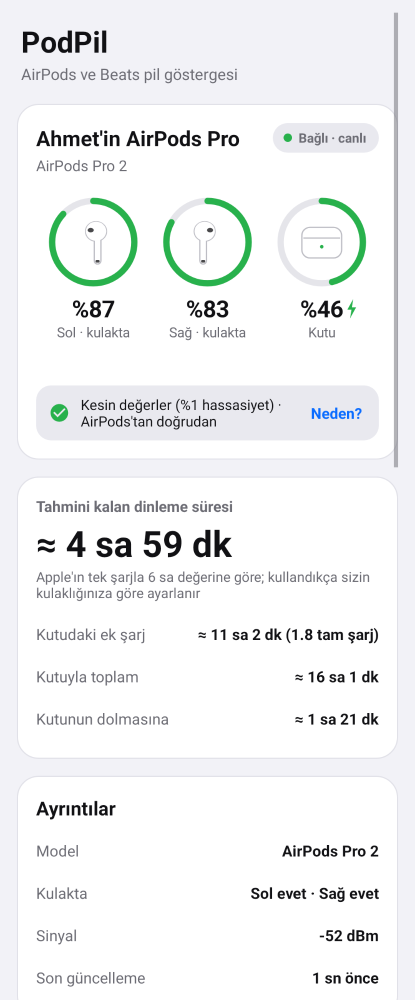
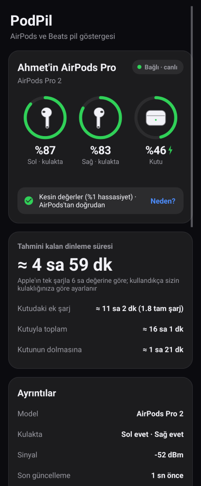
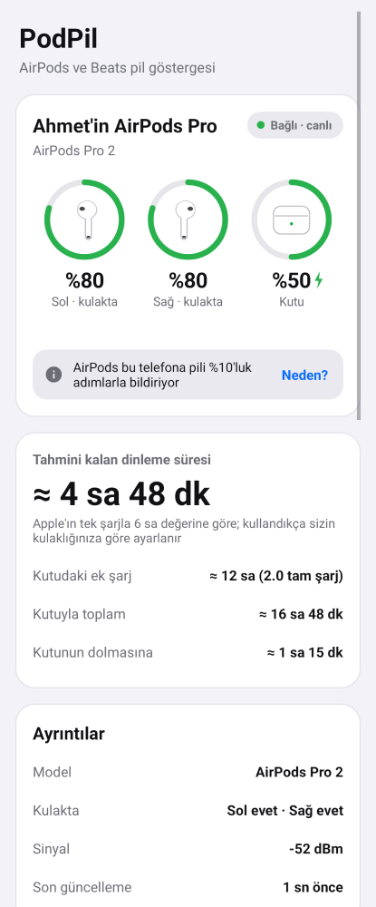
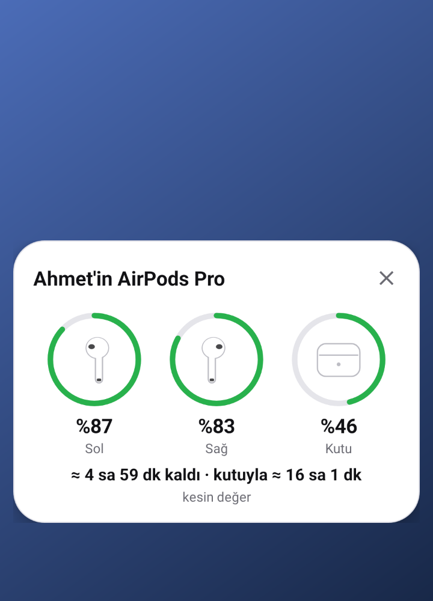
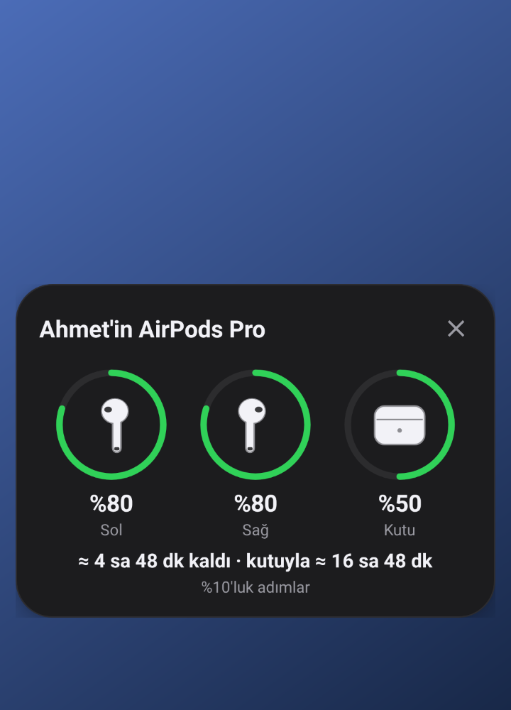

# PodPil

AirPods (ve Beats) kulaklıklar bağlandığında sol kulaklığın, sağ kulaklığın ve kutunun pilini ayrı ayrı gösterir. Ayrıca pilin daha ne kadar gideceğini tahmin eder. Bağlanınca ekranın altında bir pencere açılır; pil durumu bildirimde de sürekli görünür.

  

 

## Kurulum (APK)

1. [`apk/PodPil-1.0.apk`](apk/PodPil-1.0.apk) dosyasını telefona indirin (93 KB). Dosyayı açın; Android "bilinmeyen kaynaklardan yükleme" izni isterse verin.
2. PodPil'i açın ve **Yakındaki cihazlar** iznini verin. Bu izin, AirPods'un pil yayınını okumak için gerekir.
3. Bağlanınca açılan pencereyi istiyorsanız **Diğer uygulamaların üzerinde göster** iznini açın.
4. AirPods'u bağlayın. Pil durumu birkaç saniye içinde görünür.

Android 6.0 ve üzeri sürümlerde çalışır.

## Pil değerleri ne kadar kesin?

AirPods pilini iki yolla bildirir. PodPil hangisi mümkünse onu kullanır ve ekranda hangisinin kullanıldığını yazar.

| Kaynak | Hassasiyet | Ne zaman |
|---|---|---|
| **AirPods'a doğrudan bağlantı** (Apple'ın aksesuar kanalı, AAP) | **%1** (ör. %87), anlık | Telefonun Bluetooth sistemi izin veriyorsa |
| **Şifreli yayın**, AirPods'un kendi anahtarıyla çözülür | **%1** | Anahtarlar bir kez alındıktan sonra |
| **Açık yayın** | %10 adımlarla (%80, %90…) | Her telefonda |

- **%10 adımlar:** AirPods'un her cihaza açık olarak yaptığı Bluetooth yayınında pil %10'luk adımlarla bulunur. AndroPods gibi uygulamalar da bu değeri gösterir. Bu değer tahmin değildir, AirPods'un gönderdiği değerdir; yalnızca kaba adımlıdır.
- **Doğrudan bağlantı (tam yüzde):**
  - Doğrudan bağlantıyı birçok Android sürümündeki bir Bluetooth hatası engeller (Google hata kaydı 371713238).
  - Hata, güncel sürümlerde düzeltiliyor. Ör. Pixel'de Android 16/17 sürümlerinde düzeltildiği bildiriliyor; diğer markalar sırayla güncelliyor.
  - PodPil her bağlantıda doğrudan bağlanmayı dener; telefon güncellenince kendiliğinden çalışmaya başlar.
- **Anahtarlar:**
  - Doğrudan bağlantı bir kez kurulursa AirPods kendi anahtarlarını verir. PodPil bunları saklar.
  - Bundan sonra doğrudan bağlantı kopsa bile yayının şifreli kısmından %1 hassasiyetle okur ve sizin AirPods'unuzu çevredekilerden kesin olarak ayırır.
  - Mac'iniz varsa anahtarları elle de girebilirsiniz: Anahtar Zinciri Erişimi → "MobileBluetooth" kaydı → MagicAccEncKey ve MagicAccIRK.
- **Root gerekmez.**

## Özellikler

- **Ayrı ayrı pil:**
  - Sol, sağ ve kutu; her biri halka göstergeyle birlikte.
  - Şarj olanlarda ⚡ işareti görünür; kulaktaki kulaklık "kulakta" olarak işaretlenir.
  - Renkler: %20'nin altında turuncu, %10'un altında kırmızı.
  - AirPods Max gibi tek pilli modellerde tek gösterge vardır.
- **Tahmini süre:**
  - **Kalan dinleme süresi:** Apple'ın her model için açıkladığı süreden (ör. AirPods Pro 2 için tek şarjla 6 saat) hesaplanır. Pil %10 adımlıyken iki adım arasında da geri sayar.
  - **Kendi kulaklığınıza göre ayar:** Kullandıkça PodPil, sizin kulaklığınızın pili gerçekte ne hızla tükettiğini ölçer. Yeterli ölçüm olunca hesap ona göre yapılır; ekranda "Sizin kulaklığınızın gerçek tüketimine göre" yazar.
  - **Kutu:** kaç saatlik ek şarj ve kaç tam şarj kaldığı, kutuyla toplam süre, kutu şarj oluyorsa dolmasına kalan süre.
  - **Şarj:** kulaklıklar kutuda şarj oluyorsa tam dolmasına kalan süre.
- **Açılır pencere:** AirPods bağlandığında ekranın altından kayarak açılır ve 12 saniye sonra kapanır. Dokununca uygulama açılır.
- **Bildirim:** `Sol %87 · Sağ %83 · Kutu %46` ve "≈ 4 sa 59 dk kaldı · kutuyla ≈ 16 sa".
- **Düşük pil uyarısı:** %10, %20 veya %30'da bir kez uyarır; uyarı kapatılabilir.
- **Ayrıntılar:** model, kulakta mı, kutu kapağı açık mı, sinyal gücü, son güncelleme.
- **Desteklenen modeller:**
  - AirPods 1, 2, 3 ve 4; AirPods Pro, Pro 2 (Lightning ve USB-C) ve Pro 3; AirPods Max.
  - Bazı Beats modelleri.
  - Tanınmayan modellerde de pil gösterilir.
- Telefon açılınca otomatik başlar. Açık ve koyu tema; Türkçe ve İngilizce dil desteği.
- **İnternet izni yoktur.**

## Nasıl çalışıyor?

- **Yayın:** AirPods saniyede birkaç kez Apple'ın "proximity pairing" Bluetooth LE mesajını gönderir. Bu mesajda şunlar bulunur:
  - Model kodu.
  - Pil değerleri (0–10 arası; 15 = bilinmiyor).
  - Şarj, kulakta ve kutu kapağı bitleri.
  - 16 baytlık şifreli kısım. Bu kısım AES ile çözülünce %1'lik değerleri verir.

  PodPil bu mesajları yalnızca bir kulaklık bağlıyken veya uygulama açıkken dinler.
- **Doğru kulaklığı seçmek:**
  - Anahtar (IRK) varsa Bluetooth adresinin size ait olup olmadığı kesin olarak hesaplanır.
  - Anahtar yoksa en güçlü sinyal seçilir; uzaktaki (-65 dBm'den zayıf) kulaklıklar yok sayılır.
  - Telefon cepteyken sinyal zayıflarsa ve 10 saniye boyunca hiçbir şey duyulmazsa, daha zayıf sinyal de kabul edilir.
- **Doğrudan bağlantı:**
  - L2CAP kanalı (PSM 0x1001) üzerinden Apple'ın aksesuar protokolü kullanılır.
  - Sırasıyla tanışma, bildirim isteği ve anahtar isteği gönderilir.
  - Pil mesajında her parça için tam yüzde ve şarj durumu bulunur.
- **Arka plan:** Ön plan servisi, "bağlı cihaz" (connectedDevice) türündedir. Kulaklık bağlı değilken tarama yapmaz.

Protokol ayrıntıları için açık kaynak [CAPod](https://github.com/d4rken-org/capod), [OpenPods](https://github.com/adolfintel/OpenPods) ve [LibrePods](https://github.com/kavishdevar/librepods) projelerinin çalışmalarından yararlanıldı.

## Nasıl test edildi?

`./gradlew testReleaseUnitTest` 16 test çalıştırır:

- **`CoreTest` (10 test):**
  - Yayın çözümü: sol/sağ yer değiştirmesi, şarj ve kulakta bitleri, kapak, bilinmeyen değerler, tek pilli modeller.
  - Şifreli kısmın AES ile çözülmesi. Yanlış anahtar veya başka bir kulaklığın verisi reddediliyor.
  - IRK ile adres eşleştirmesi Bluetooth çekirdek şartnamesindeki örnek değerle (`ah = 0x0DFBAA`) doğrulandı.
  - Aksesuar protokolü pil ve anahtar mesajları.
  - Süre tahmini ve gerçek tüketimi ölçme (dakika dakika simülasyonla).
- **`ServiceTest` (6 test, Robolectric, gerçek servis):**
  - Kulaklık bağlanınca bildirimde `Sol %70 · Sağ %80 · Kutu %60 ⚡` ve "≈ 4 sa 12 dk kaldı · kutuyla ≈ 18 sa 36 dk" görünüyor.
  - Doğrudan bağlantı %1'lik değerleri getiriyor ve anahtarlar kaydediliyor. Sonrasında şifreli yayından %87 / %83 gibi değerler okunuyor; başkasının güçlü sinyali yok sayılıyor.
  - Uzaktaki ve zayıf sinyaller eleniyor.
  - Düşük pil uyarısı bir kez çıkıyor. Bağlantı kopunca son durum saklanıyor.
  - Açılır pencere ilk pil bilgisiyle birlikte açılıyor.
  - Ana ekran değerleri, tahmini ve kaynağı doğru gösteriyor.

Android Lint 0 hata verdi. Ekranlar açık ve koyu temada çizdirilip kontrol edildi.

**Test edilemeyen:** Bu ortamda gerçek telefon ve AirPods olmadığı için uygulama gerçek cihazla denenemedi. Özellikle doğrudan bağlantı (tam yüzde) yalnızca protokol belgelerine ve testlere dayanıyor; hangi telefonlarda çalıştığı telefonun Android sürümüne bağlı.

## Bilinen sınırlamalar

- **Tam yüzde:** Telefonunuz doğrudan bağlantıya izin vermiyorsa ve anahtar girilmediyse değerler %10 adımlı kalır. Bu, Android'in bir sınırlamasıdır; ayarlarda durum yazılı olarak gösterilir.
- **Tahmin:** Süreler tahminidir. Ses seviyesi, gürültü engelleme (ANC) ve pilin yaşı süreyi değiştirir. Uygulama kullandıkça kendi ölçümüne geçer.
- **Kutu:** Kutu pili yalnızca en az bir kulaklık kutudayken veya kapak açıkken bilinir. AirPods kutu bilgisini sadece bu durumlarda gönderir.
- **Xiaomi / HyperOS ve benzerleri:** Arka planda kapanmaması için pil optimizasyonunu kapatın ve otomatik başlatmayı açın.
- **İmza:** APK debug anahtarıyla imzalıdır. Farklı bir ortamda derlenen sürüm üzerine kurulmazsa önce eskisini kaldırın.
- PodPil'in Apple ile bir bağlantısı yoktur. AirPods, Apple Inc.'in ticari markasıdır.

## Kaynaktan derleme

```bash
cd pod-battery
export ANDROID_HOME=/android/sdk/yolu
./gradlew assembleRelease        # app/build/outputs/apk/release/app-release.apk
./gradlew testReleaseUnitTest    # testler (Robolectric)
```

| Dosya | Görev |
|---|---|
| `core/Proximity.java` | Bluetooth yayınını çözme (model, piller, şarj, kulakta, kapak) |
| `core/Crypto.java` | Şifreli kısmı çözme, IRK ile kendi kulaklığını tanıma |
| `core/Aap.java` | Aksesuar protokolü paketleri (pil, anahtarlar) |
| `core/Estimator.java`, `core/Models.java` | Süre tahmini, tüketimi ölçme, model listesi |
| `PodService.java`, `AapClient.java` | Arka plan servisi, tarama, doğrudan bağlantı, bildirim, uyarı |
| `PodsView.java`, `Popup.java`, `MainActivity.java` | Pil halkaları, açılır pencere, ana ekran |
