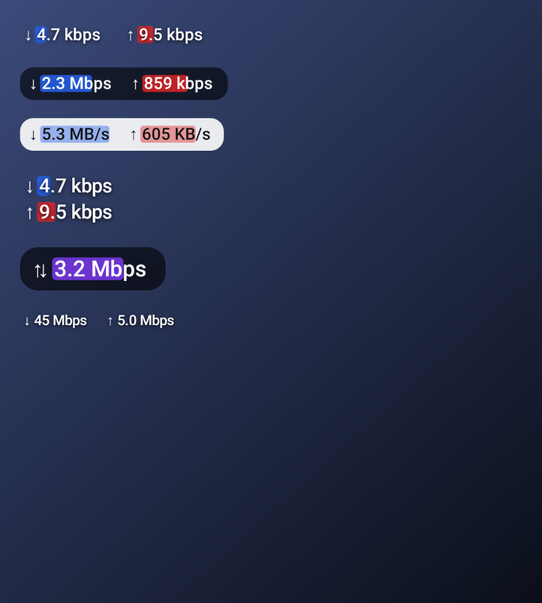
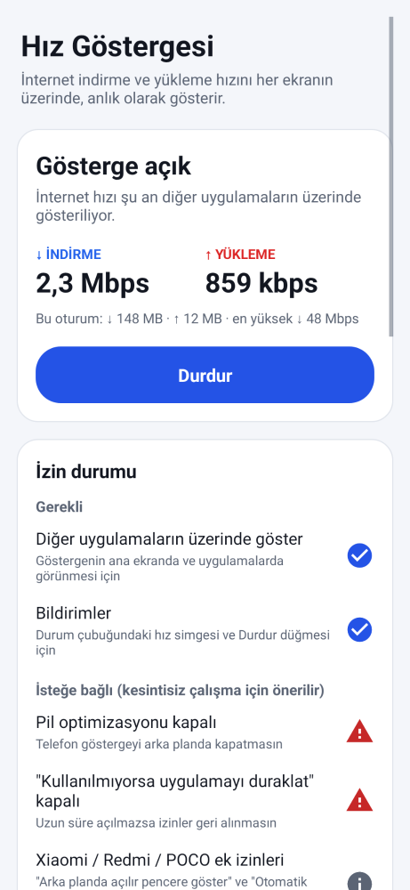
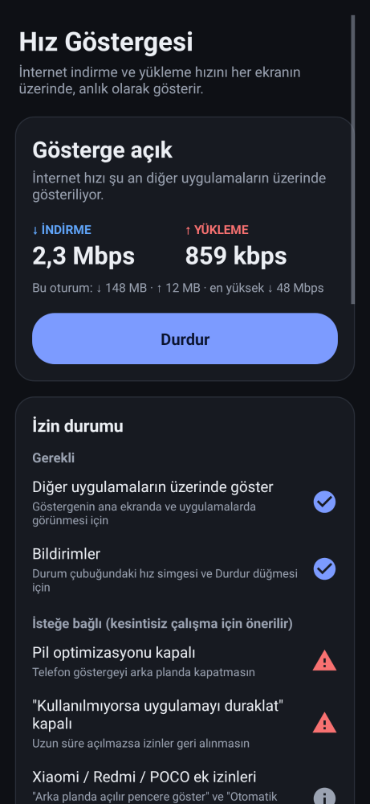

# Hız Göstergesi

İnternet **indirme (↓)** ve **yükleme (↑)** hızını anlık olarak, ana ekranda ve tüm uygulamaların üzerinde küçük bir göstergeyle gösterir. Hız ayrıca durum çubuğundaki simgede de görünür.

  

## Kurulum (APK)

1. [`apk/HizGostergesi-1.0.apk`](apk/HizGostergesi-1.0.apk) dosyasını telefona indirin (60 KB).
2. Dosyayı açın. Android "bilinmeyen kaynaklardan yükleme" izni isterse verin.
3. Uygulamayı açıp **Başlat**'a dokunun. **Diğer uygulamaların üzerinde göster** iznini açıp uygulamaya geri dönün.

Android 6.0 ve üzeri sürümlerde çalışır.

## Özellikler

- **Ekranın üzerinde canlı hız:** `↓ 2.3 Mbps   ↑ 859 kbps` gibi görünür. Varsayılan olarak durum çubuğunun hemen altında, sol üstte durur.
- **Hız çubukları:** Değerlerin arkasında mavi (indirme) ve kırmızı (yükleme) çubuklar olur. Çubuğun boyu hıza göre değişir ve logaritmik ölçek kullanır; böylece 10 kbps ile 100 Mbps arası farklar da görünür.
- **Durum çubuğu simgesi:** Bildirim simgesinin içine o anki indirme hızı yazılır (ör. "2.3" ve altında "Mbps"). Bildirimde iki hız, o oturumda indirilen/yüklenen veri miktarı ve **Durdur** düğmesi bulunur.
- **Görünüm ayarları:** Değişiklikler canlı önizlemede ve açık olan göstergede anında görünür.
  - **Gösterilecek:** ikisi / sadece indirme / sadece yükleme / toplam.
  - **Düzen:** yan yana / alt alta.
  - **Birim:** Mbps (bit) veya MB/s (bayt).
  - **Yazı boyutu:** dört seçenek.
  - **Arka plan:** yok / koyu / açık.
  - **Yazı rengi:** beyaz / siyah.
  - **Görünürlük:** %30–100.
  - **Yenileme sıklığı:** 0,5 / 1 / 2 saniye.
- **Konum:**
  - Kilit açıkken göstergeyi parmağınızla sürükleyerek istediğiniz yere taşıyabilirsiniz.
  - Kilitliyken dokunuşlar göstergenin arkasındaki uygulamaya geçer.
  - "Konumu sıfırla" göstergeyi sol üst köşeye geri alır.
- **İzin durumu:** Gerekli izinler (üstte gösterme, bildirimler) ve isteğe bağlı izinler (pil optimizasyonu, "kullanılmıyorsa uygulamayı duraklat") ✓ veya ⚠ olarak gösterilir. Bir satıra dokunmak ilgili ayar ekranını açar. **Xiaomi / Redmi / POCO** telefonlarda ek olarak "arka planda açılır pencere" ve "otomatik başlatma" için hatırlatma çıkar.
- **Hızlı Ayarlar kutucuğu:** Göstergeyi tek dokunuşla açar ve kapatır.
- **Telefon açılınca otomatik başlatma** (isteğe bağlı). Uygulama güncellendiğinde gösterge açıksa kendiliğinden yeniden açılır.
- **Pil dostu:** Ekran kapanınca ölçüm durur, ekran açılınca devam eder.

## Nasıl çalışıyor?

- **Ölçüm:** Hız, Android'in tüm ağ trafiği sayaçlarından (`TrafficStats`, Wi-Fi ve mobil veri dahil) her saniye ölçülür. Sayaç sıfırlanırsa (ağ değiştiğinde) eksi hız gösterilmez. Uzun bir aradan sonra (ekran kapalıyken) ortalama hesaplanmaz. Telefon sayaçları desteklemiyorsa "desteklenmiyor" yazılır.
- **Ekrandaki gösterge:** Uygulama, "diğer uygulamaların üzerinde göster" izniyle küçük, odak almayan bir pencere açar.
- **Android 12+ ve dokunuşlar:** Bu sürümlerde opaklığı %80'in üzerindeki üst pencereler alttaki uygulamaya giden dokunuşları engeller. Bu yüzden kilitliyken pencerenin opaklığı en fazla %80 tutulur ve dokunuşlar engellenmez.
- **Arka plan servisi:** Gösterge bir ön plan servisinde çalışır. Android 14+ için türü "özel kullanım" (specialUse) olarak tanımlıdır.

## Nasıl test edildi?

`./gradlew testReleaseUnitTest` 11 test çalıştırır:

- **`CoreTest` (7 test):**
  - Hız biçimleri ekran görüntünüzdeki gibi çıkıyor: `4.7 kbps`, `9.5 kbps`, `859 kbps`, `2.3 Mbps`. Türkçe telefonda `2,3 Mbps`.
  - Hiçbir zaman "1000 kbps" gibi taşma yazılmıyor.
  - Bayt birimleri, veri miktarı ve çubuk ölçeği doğru.
  - Sayaç sıfırlanması, uzun aralar ve desteklenmeyen sayaçlar doğru işleniyor.
- **`MonitorServiceTest` (4 test, Robolectric ile gerçek servis):**
  - Üstteki pencere doğru türde ve doğru bayraklarla ekleniyor. Kilitliyken dokunuşlar geçiyor, opaklık ≤ %80.
  - 1 saniyelik trafikten **2.3 Mbps / 859 kbps** ölçülüyor ve bildirim başlığına yazılıyor.
  - Durum çubuğu simgesi hız yazılmış bir resim olarak oluşuyor.
  - Kilit açılınca gösterge sürüklenebilir hale geliyor; konum ve görünürlük ayarları anında uygulanıyor.
  - İzin yokken yalnızca bildirim çalışıyor.
  - Durdur'a basınca gösterge kaldırılıyor.

Android Lint 0 hata verdi. Gösterge stilleri ve uygulama ekranı çizdirilip kontrol edildi.

**Test edilemeyen:** Bu ortamda emülatör olmadığı için uygulama gerçek bir telefonda çalıştırılamadı.

## Bilinen sınırlamalar

- **Durum çubuğunun üstü:** Android, uygulamaların durum çubuğunun *üzerine* çizmesine izin vermez. Bu yüzden gösterge varsayılan olarak durum çubuğunun hemen altında durur. Sürükleyerek yerini değiştirebilirsiniz.
- **Tam ekran:** Bazı telefonlarda gösterge tam ekran video veya oyunların üzerinde de görünür. İsterseniz Hızlı Ayarlar kutucuğuyla kapatabilirsiniz.
- **Xiaomi / HyperOS:** Ek izinler kapalıysa sistem göstergeyi gizleyebilir veya kapatabilir. Uygulamadaki Xiaomi satırına dokunun ve "Arka planda açılır pencere göster" ile "Otomatik başlatma" seçeneklerini açın.
- **İmza:** APK debug anahtarıyla imzalıdır. Farklı bir ortamda derlenen bir sürüm eskisinin üzerine kurulmazsa önce eskisini kaldırın.

## Kaynaktan derleme

```bash
cd speed-meter
export ANDROID_HOME=/android/sdk/yolu
./gradlew assembleRelease        # app/build/outputs/apk/release/app-release.apk
./gradlew testReleaseUnitTest    # testler (Robolectric)
```

| Dosya | Görev |
|---|---|
| `core/SpeedFormat.java`, `core/SpeedSampler.java` | Hız biçimlendirme ve ölçüm (saf Java, test edilebilir) |
| `MonitorService.java` | Üstteki pencere, saniyelik ölçüm, sürükleme, durum çubuğu simgesi |
| `SpeedView.java` | Göstergeyi çizen görünüm (oklar, değerler, hız çubukları) |
| `Style.java` | Görünüm ve davranış ayarları |
| `MainActivity.java`, `Permissions.java` | Ana ekran, izin durumu, ayarlar |
| `MeterTileService.java`, `BootReceiver.java` | Hızlı Ayarlar kutucuğu, açılışta başlatma |
