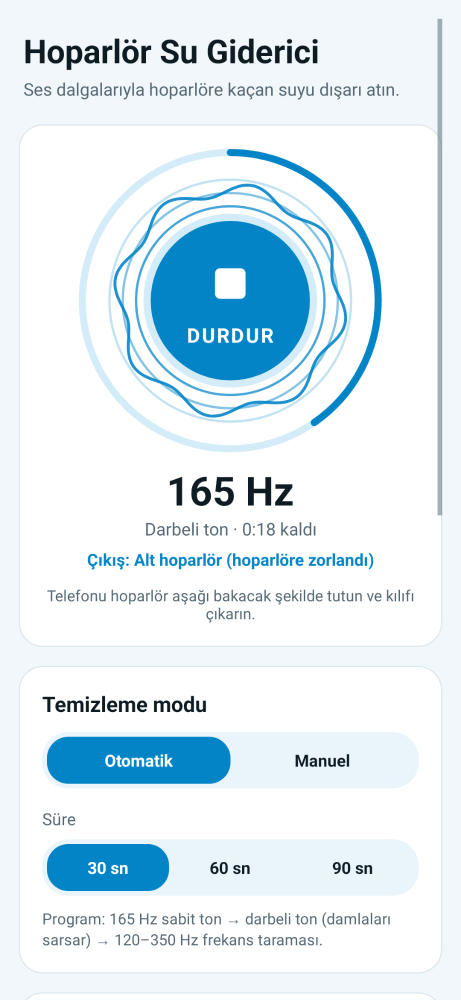

# Su Giderici (Hoparlör Su Giderici)

Düşük frekanslı ses dalgalarıyla telefon hoparlörüne kaçan suyu dışarı atan Android uygulaması.

Islanan telefonlar genellikle kulaklık takılı sanır ve sesi hoparlörden vermez. Uygulama bunun için [Kulaklık Kapat](../disable-headphone/) ile aynı yöntemi kullanır: kulaklık takılı görünse bile ses telefonun kendi hoparlöründen çıkar.



## Kurulum (APK)

1. [`apk/SuGiderici-1.0.apk`](apk/SuGiderici-1.0.apk) dosyasını telefona indirin.
2. Dosyayı açın. Android "bilinmeyen kaynaklardan yükleme" izni isterse verin.
3. **Yükle**'ye dokunun.

Android 6.0 ve üzeri sürümlerde çalışır. Root gerekmez.

## Kullanım

1. Kılıfı çıkarın ve telefonu hoparlör aşağı bakacak şekilde tutun.
2. **BAŞLAT**'a dokunun. Ses seviyesi otomatik olarak en yükseğe çıkar, bitince eski haline döner.
3. Ses hâlâ boğuk geliyorsa 2–3 kez tekrarlayın.

Temizlik ekran kapalıyken de sürer. Bildirimden durdurabilirsiniz.

### Modlar

| Mod | Ne yapar |
|---|---|
| **Otomatik** (30 / 60 / 90 sn) | 1) %0–35: **165 Hz sabit ton**, hoparlör zarını en çok hareket ettiren düşük frekans. 2) %35–65: **darbeli ton**, 0,25 sn açık / 0,15 sn kapalı; her başlangıç damlaları sarsar. 3) %65–100: **120–350 Hz frekans taraması**, farklı ızgara boyutlarının rezonansını yakalar. |
| **Manuel** | 50–500 Hz arası frekans (hazır: 100 / 165 / 200 / 300 Hz) ve **sinüs** ya da daha güçlü **kare** dalga. Siz durdurana kadar çalar, en fazla 3 dakika. Frekans çalarken değiştirilebilir. |

### Hoparlör seçimi

- **Alt hoparlör:** müzik ve video sesinin çıktığı ana hoparlör.
- **Üst hoparlör (ahize):** görüşmede kulağınıza dayadığınız hoparlör. Ses bu sırada "iletişim modu" üzerinden ahizeye gönderilir.

### Seçenekler

- **Sesi otomatik en yükseğe çıkar:** Ses en yükseğe çıkar, bitince önceki seviyeye döner.
- **Titreşimle destekle:** Ton boyunca telefon titrer.
- **Kulaklık takılı görünse bile hoparlörü zorla** (varsayılan açık): Aşağıdaki yönlendirme mantığını çalıştırır.

## Hoparlöre zorlama nasıl çalışıyor?

1. Ton `AudioTrack.setPreferredDevice(dahili hoparlör)` ile doğrudan hoparlöre istenir.
2. Uygulama her saniye sesin gerçekte hangi cihazdan çıktığını kontrol eder (`getRoutedDevice`, Android 7+). Android 6'da bunun yerine takılı kulaklık listesine bakılır.
3. Ses hoparlör dışında bir yere gidiyorsa *Kulaklık Kapat*'ın `AudioRouter` sınıfı devreye girer:
   - Android 6–8: medya sesi doğrudan hoparlöre zorlanır (`AudioSystem.setForceUse`).
   - Android 8+: iletişim modu açılır ve hoparlör seçilir. Bu modda medya sesi arama sesiyle sınırlandığı için arama sesi de en yükseğe çıkarılır.
4. Bitince yönlendirme, ses seviyeleri ve ses odağı eski haline döner.

Gelen bir arama ya da sesi isteyen başka bir uygulama olursa (ses odağı kaybı) temizlik otomatik olarak durur.

## Bilinen sınırlamalar

- Uygulama yalnızca hoparlör ızgarasındaki suyu atar. **Şarj girişini kurutmaz.** Telefon tamamen kurumadan şarja takmayın.
- Ses yüksek olabilir. Çalarken telefonu kulağınıza yaklaştırmayın.
- Ne kadar suyun atılacağı telefonun hoparlörüne ve ızgarasına bağlıdır. Bu, bir onarım yerine geçmez.
- APK bu derleme ortamının debug anahtarıyla imzalıdır. Başka ortamda derlenen bir sürüm, eskisinin üzerine kurulmayabilir. Bu durumda önce eski sürümü kaldırın.

## Kaynaktan derleme ve testler

```bash
cd water-eject
export ANDROID_HOME=/android/sdk/yolu
./gradlew assembleRelease        # app/build/outputs/apk/release/app-release.apk
./gradlew testReleaseUnitTest    # ses üretici birim testleri
```

`ToneProgramTest` ses üreticisini Android olmadan test eder. Kontrol edilenler:
- Sabit bölümün 165 Hz olması
- Darbeli bölümde ses ve sessizlik aralıklarının bulunması
- Taramanın 120–350 Hz aralığını kapsaması
- Sesin hiçbir yerde kırpılmaması (clipping)
- Başlangıç, bölüm geçişleri, frekans değişimi ve bitiş sırasında "tık" sesi çıkaran ani sıçramalar olmaması
- Sürenin doğru olması

### Dosyalar

| Dosya | Görev |
|---|---|
| `ToneProgram.java` | Ses dalgası üretimi (otomatik program, manuel ton, yumuşak başlangıç/bitiş) |
| `ToneEngine.java` | Ses kanalı, ayrı ses iş parçacığı, hoparlör/ahize seçimi |
| `CleanService.java` | Ön plan servisi: ses odağı, ses seviyesi, hoparlöre zorlama, titreşim, bildirim |
| `AudioRouter.java` | Kulaklık Kapat'tan alınan hoparlöre zorlama mantığı (ve ahize modu) |
| `WaveView.java` | Dairesel ses dalgası animasyonu ve ilerleme halkası |
| `MainActivity.java` | Ana ekran ve ayarlar |
